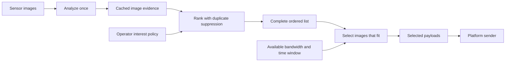

# Ranking and selection

**Ranking answers “Which images add the most useful information?” Selection answers “Which of those images fit the available transmission allowance?”** Duplicate suppression belongs in ranking. Absolute bandwidth belongs in selection.

This document records the agreed design. The current prototype still combines duplicate-aware ordering and budget selection inside `select_records()`. The implementation status below distinguishes the existing APIs from the planned separation; this documentation update does not change runtime behavior.

## The agreed pipeline



| Stage | Inputs | Result | What causes it to change? |
|---|---|---|---|
| Image analysis | Image pixels and chosen engine | Detections, novelty, quality, similarity fingerprint | New images or a different engine/configuration |
| Ranking | Cached evidence and operator policy | Complete ordered list with base scores, adjusted scores and reasons | New/removed images, changed evidence, or changed interest policy |
| Selection | The ordered list, actual payload sizes, bandwidth and time window | A subset preserving the list's relative order | Available bandwidth, time window, or encoded payload sizes |
| Transmission | Selected payloads and live connection | Send attempts, acknowledgements and pending payloads | Link availability and delivery results |

The ranking is stable **for the same candidate set, evidence and policy**. Increasing bandwidth alone does not change its scores, duplicate penalties or order. New frames and operator changes can legitimately produce a new ranking. The platform sender is a separate integration responsibility; the current prototype does not transmit files.

## Ranking includes soft duplicate suppression

First compute each image's base relevance from the existing evidence: supported object detections, spatial novelty and a small quality adjustment. Then build the full ordered list:

1. Put the image with the highest current adjusted score next in the list.
2. Compare remaining images with images already placed earlier in that list.
3. Reduce the adjusted scores of similar images, so a useful different view can move ahead of a repeated view.
4. Continue until all eligible images have a position. Break ties deterministically by observation ID.

This is **soft suppression**, not deletion. Similar images remain available farther down the list. A coarse fingerprint can miss a small meaningful change, so it must not be treated as proof that two observations contain identical information.

The similarity penalty is computed against **earlier ranked images**, regardless of which images a later bandwidth setting selects. In the agreed design, byte size does not boost or reduce an image's importance, and ranking does not reserve a percentage of the transmission budget for coverage. Uniform sampling remains a separate evaluation baseline.

A possible adjustment using the existing similarity heuristic is:

```text
adjusted_score = base_score × (1 − duplicate_strength × maximum_similarity_to_earlier_ranked_images)
```

The base score stays fixed; the adjusted score evolves as the full list is constructed. Once that list is built, selection uses it without recomputing similarity or scores. These are heuristic scores, not probabilities or validated object identities.

## Selection uses an absolute allowance

The main setting is `available_bandwidth_bps`: effective outbound payload bits per second allocated to this image service. Supply the allocation after other traffic and transport costs have been accounted for. Use decimal units: 1 kbps = 1,000 bps, 1 Mbps = 1,000,000 bps; KB and MB below also use decimal units.

```text
budget_bytes = floor(available_bandwidth_bps × window_seconds / 8)
```

| Demo condition | Available bandwidth | Payload allowance over 60 seconds |
|---|---:|---:|
| Normal | 2 Mbps | 15 MB |
| Degraded | 256 kbps | 1.92 MB |
| DDIL | 64 kbps | 480 KB |
| Severe DDIL | 9.6 kbps | 72 KB |
| Disconnected | 0 bps | 0 bytes |

These are adjustable application-level test presets, not measured or specified destroyer capacities. The [setup guide](README.md#absolute-bandwidth-control) gives the public context and working CLI options. A constant-rate allowance does not simulate latency, interruptions, retries or packet pacing.

Selection walks the ranked list from top to bottom. If an image fits the remaining byte allowance, select it and subtract its encoded size. Otherwise skip it for this pass and try the next image. Skipped images remain pending; selection does not reorder the list or recompute duplicate penalties. Zero bandwidth selects nothing.

For equal-size payloads, this reduces to taking the first `floor(budget_bytes / image_size_bytes)` entries, capped by the number available. A single sensor usually fixes pixel dimensions; JPEG file sizes can still vary with scene detail and compression.

### Worked example

Suppose the ranking has already placed a different view C ahead of image B, which resembles A. These example sizes are illustrative, not measurements from the dataset:

| Fixed rank | Image | Why it has this position | JPEG size |
|---|---|---|---:|
| 1 | A | Highest base relevance | 300 KB |
| 2 | C | Useful different view | 200 KB |
| 3 | B | Similar to A, so its adjusted score is lower | 100 KB |

| Bandwidth, over 60 seconds | Selection | Actual payload bytes |
|---|---|---:|
| 9.6 kbps: 72 KB allowance | None fits | 0 |
| 64 kbps: 480 KB allowance | A, then B; C does not fit after A | 400 KB |
| 256 kbps: 1.92 MB allowance | A, C, B | 600 KB |

**The ranking stays A, C, B in every case.** Selection can have gaps because whole JPEG sizes vary. The sender may choose a lower-ranked repeated view when a higher-ranked different view cannot fit. That is a consequence of this simple packing rule, not a change in ranking.

If an earlier-ranked image is skipped, similar lower-ranked images keep the penalty computed during ranking. Selection does not try to correct that penalty for each budget. Adapting diversity to the actually transmitted set would be a different design and would reintroduce the coupling this separation is intended to avoid.

## Interface and implementation status

The desired handoff is a complete ranking that can be reused across several bandwidth settings. Keep an image's **priority rank** distinct from its **position among selected images**. The following describes the design contract; separate ranking and selection functions are not yet available.

| Concern | Current prototype | Agreed separation |
|---|---|---|
| Base scoring | `score_record()` reads evidence and policy, without bandwidth or deduplication | Remains part of ranking |
| Full ranking | No standalone complete ranking is saved | Save the ordered eligible candidate set once per evidence/policy revision |
| Duplicate suppression | `select_records()` penalizes similarity to images already selected in that call | Ranking penalizes similarity to earlier entries in the full ranking |
| Image size | Current selection uses adjusted score divided by `payload_bytes ** byte_cost_exponent` | Size affects selection feasibility only |
| Representative coverage | Current selector reserves `budget_bytes * coverage_fraction` | No budget-dependent reserve in the priority ranking |
| Absolute budget | `bandwidth_budget_bytes()` already converts application bps and seconds to whole bytes | Use the same conversion in the separate selection step |
| Rank output | Current `rank` field is a position within the selected subset | Preserve priority rank and record selection position separately |
| CLI | `rank` currently runs combined prioritization and selection from cached evidence | A bandwidth-only change should reuse an existing full ranking |
| Timing | Current `selection_ms` includes scoring, duplicate updates and packing | Measure ranking time and selection time separately |

Setting `byte_cost_exponent` to zero in the current implementation removes its explicit preference for small files. It does **not** create the agreed separation: the coverage reserve, affordability filtering and selected-set duplicate suppression still depend on the budget.

The future live sender will also need acknowledgement handling, a pending queue and a defined policy for frames too large to fit one window. Fragmentation, accumulated transmission credit and previously transmitted duplicate history are not implemented. An acknowledgement changes the pending candidate set, which can trigger a new ranking; merely changing bandwidth must not.

## Evaluate the two stages separately

For ranking, inspect useful images near the top, redundant views, and missed small changes under a fixed candidate set and policy. With suitable reviewed labels, precision/recall at fixed list positions can measure order quality without a bandwidth choice. Such ranking metrics and a stable full-ranking output are not implemented yet.

For selection, report **Mbps/kbps, window duration, allowed bytes, selected bytes, unused bytes, selected image count and labelled-image coverage**. Compare all methods using identical encoded JPEGs and the same absolute allowance. More delivered images or higher delivered recall under a larger allowance does not mean that the detector became more accurate.

The existing labels support annotated-object image coverage, not operator interest, unique-event recall or detector localization accuracy. Current reports evaluate the existing combined selector; they are not results from the proposed separated pipeline. Dataset-percentage budgets remain a historical reproduction option in the [setup guide](README.md), rather than the main description of connectivity.
