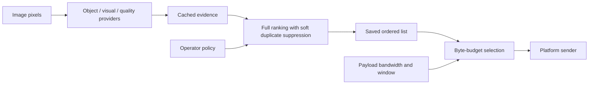

# Ranking and selection

Ranking answers which observations should come first. Selection answers which whole image payloads fit the available allowance. The separation is implemented: **bandwidth and payload size cannot change the full priority ranking** for a fixed pool, evidence and policy.



The sender is a future integration. This prototype produces local files and reports; it does not transmit them.

## Base score

`policy.score_record(record, policy)` uses only cached evidence and policy. Object relevance has two modes:

1. If `object_relevance` is a number, use it directly. Zero is a valid supplied score. Any accompanying detections remain display metadata and do not affect relevance through class weights.
2. Otherwise, take the maximum `confidence × class_weight` over detections. Unlisted labels use `default_object_weight`. `detections=[]` means evaluated with no hits; `detections=null` means object evidence was not evaluated.

The priority base score is:

```text
visual_contribution = visual_interest × visual_interest_weight
base_score = max(object_relevance_or_zero, visual_contribution)
             × (1 − quality_weight × (1 − quality))
```

This keeps visual interest eligible without a recognized object. Quality is a soft modifier rather than a separate source of importance. Default object and visual weights are both 0.65; quality weight is 0.10. The policy is configurable. `visual_interest` is the canonical signal; `novelty` remains a compatibility alias, not a claim of reliable unknown-object detection.

Direct object relevance is already interpreted by its provider. If the UI must change priorities by category without rerunning inference, use detections with `relevance=None`. Changing policy cannot create a recognition capability absent from the cached evidence.

## Full ranking and similarity

`policy.rank_records(records, policy=None, method="priority")` returns every eligible observation in a complete deterministic order. It does not read payload bytes or take a bandwidth argument.

For priority ranking:

1. Compute each observation's base score.
2. Pick the highest currently adjusted score; break ties by observation ID.
3. Update remaining observations' maximum similarity to entries already ranked.
4. Repeat until all eligible observations have a position.

```text
final_score = base_score × (1 − duplicate_strength × max_similarity)
```

The default duplicate strength is 0.85. Similarity now uses **both cached color layout and pHash**: `min(color_similarity, phash_similarity)`. Their respective scales are `duplicate_distance=0.08` and `phash_distance_scale=8.0` bits. Both components must support a strong penalty. Missing pHash requires explicit cache migration or a color-only override; it never silently disables pHash. See [Similarity](SIMILARITY.md) for the formulas, audit fields, migration and pair evaluation. The full ranking remains O(N²D) time and O(ND) memory for N observations and D color values.

This is soft suppression: repeated views move down the list rather than being deleted. Both whole-image descriptors can overlook a small local change or respond to lighting/camera changes. It is neither a track identity nor proof that two observations contain the same information.

Similarity is measured against **earlier ranked entries**, including entries that a later budget may skip. Ranking is stable for the same candidate set, evidence and policy. New or removed images, different providers or operator changes can legitimately change it. Bandwidth alone cannot.

### Ranking fields

| Field | Meaning |
|---|---|
| `priority_rank` | One-based position in the full ranking |
| `rank` | Compatibility alias of `priority_rank` |
| `base_score`, `score` | Individual score before similarity suppression |
| `final_score`, `marginal_score` | Score when the observation entered the ranking |
| `max_similarity`, `nearest_prior_id` | Largest measured similarity to an earlier ranked entry and its ID |
| `ranking_method`, `reasons` | Method and explanations, including any redundancy penalty |

The `uniform` baseline uses deterministic representative spacing over source/time/ID order and has null scores. `detector` sorts object relevance; `novelty` sorts weighted visual interest. Those two comparison baselines do not apply priority ranking's quality or similarity adjustment. None uses payload size to establish its full order.

## Selection from the saved ranking

`selection.select_ranked(ranked_records, budget_bytes)` walks consecutive full ranks in order. It selects each whole JPEG that fits the remaining budget, skips one that does not, then tries the next. It never rescales scores or recomputes similarity.

The main bandwidth setting is the effective outbound payload allocation to this image service:

```text
budget_bytes = floor(available_bandwidth_bps × window_seconds / 8)
```

For example, 64,000 bps over 60 seconds allows 480,000 payload bytes. Decimal units apply. The default is 2 Mbps over 60 seconds. These are adjustable application scenarios, not measured Navy link capacities; the [setup guide](README.md#absolute-bandwidth) lists the presets.

Selection preserves `priority_rank` and `rank`, and adds `selection_rank` for the position within the subset. It returns copies and leaves the full ranking available to the caller. For equal-size payloads it takes the top N that fit. With unequal JPEG sizes the selected ranks can have gaps.

### Example

| Fixed rank | Image | Reason | JPEG size |
|---|---|---|---:|
| 1 | A | Highest base relevance | 300 KB |
| 2 | C | Different useful view | 200 KB |
| 3 | B | Similar to A; lower adjusted score | 100 KB |

A 480 KB allowance selects A and B because C cannot fit after A. A 1.92 MB allowance selects A, C and B. **The full order stays A, C, B.** If A itself is skipped, B retains the similarity penalty it received during ranking. Adapting diversity to only the transmitted subset would be a different, budget-dependent design.

Zero allowance selects nothing. Oversized items remain in the caller's full ranking. The prototype does not implement fragmentation, accumulated credit, a persistent queue, pacing, acknowledgements or previously transmitted history. A platform sender must manage those responsibilities explicitly.

## APIs and CLI

```python
from ghost_priority.bandwidth import bandwidth_budget_bytes
from ghost_priority.policy import rank_records
from ghost_priority.selection import select_ranked

ranked = rank_records(records, policy=policy)
selected = select_ranked(ranked, bandwidth_budget_bytes(64_000, 60))
selected_when_link_improves = select_ranked(ranked, bandwidth_budget_bytes(256_000, 60))
```

`policy.select_records(records, budget_bytes, policy)` remains a compatibility convenience that calls these two stages. Call them separately when reusing a ranking.

```bash
python -m ghost_priority rank --records runs/evidence/records.jsonl --ranking-only --out runs/ranking
python -m ghost_priority select --ranked runs/ranking/ranked-priority.jsonl --bandwidth-bps 64000 --window-seconds 60 --out runs/selection
```

Ranking-only saves `ranked-{method}.jsonl`, `ranking_summary.json` and a full-list gallery. It rejects bandwidth settings and labels. `select` reads a saved ranking and saves `selected.jsonl`, `selection_summary.json`, `comparison.json` and a selection report. Its optional labels are used only after selection. Saved payload paths are absolute and must remain accessible.

Without `--ranking-only`, `rank` computes each baseline's full order once, saves it, and reuses it for the requested budget(s). Ranking and selection times are recorded separately. Standalone selection does not repeat either image analysis or ranking.

## Evaluate and migrate

Inspect ranking quality using useful images near the top, redundancy, and small changes that were missed. Selection reports should include rate, window, allowed bytes, selected bytes, unused bytes, image count and labelled-image coverage. Compare identical JPEG representations and absolute allowances. More delivered images under a larger allowance does not mean the image model became more accurate.

Existing SMD labels support annotated-object image coverage, not operator interest, unique-event recall or localization accuracy. Historical measurements in `DATA_NOTES.md` used the earlier combined selector; they are not evidence for this separated implementation.

`novelty_weight` is accepted as an alias for `visual_interest_weight`; conflicting values fail validation. `coverage_fraction` and `byte_cost_exponent` are removed and rejected with a migration message. Remove those keys: full ranking no longer reserves a budget fraction or favors smaller files. The legacy fraction-budget CLI remains only for historical comparison; use absolute bandwidth for the platform contract.
