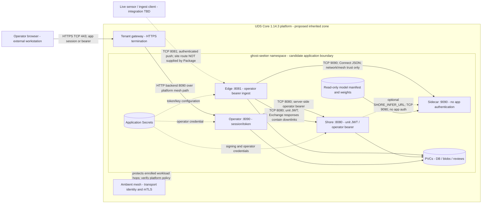
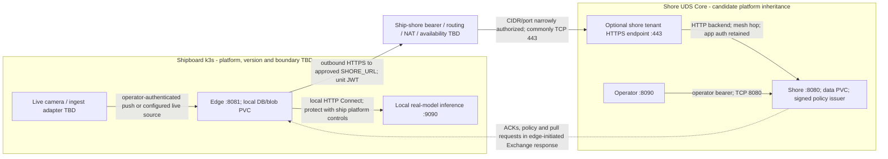

# Authorization boundary and data flows

The boundary is **proposed**, not AO-approved. Classification and all program
network addresses are TBD. Labels describe current application protocols, not
an assertion that every deployment has TLS or a verified inheritance agreement.

## Current same-cluster UDS application wiring

The storage node above groups **separate** edge/shore/operator PVCs; it is not a
shared database. Default Zarf operator arguments set `-edge=` and `-link-listen=`:
there is no default operator-to-edge bridge or development link shaper. The
edge Service is not exposed by the UDS Package. External sensor push needs a
reviewed route and network rule; its dashed arrow is a required integration,
not existing gateway ingress. See [PPSM](PPSM.md) for optional versus permitted flows.

## Proposed split ship / shore model

This is a deployment planning diagram, **not a tested second-cluster
interconnection**. Configure `UDS_CROSS_CLUSTER_SHORE`, `SHORE_EGRESS_CIDR`,
`SHORE_EGRESS_PORT`, `SHORE_URL` and receiving `UDS_EXPOSE_SHORE`; address DNS,
NAT source ranges, certificate trust and both platforms' controls. The package
does not enroll an arbitrary shipboard k3s cluster into the shore mesh or extend
its mTLS across the WAN. No unsolicited inbound shore-to-edge listener is needed
for downlinks. Agreements, endpoints and transport approval remain TBD.

## Authentication and TLS termination

| Segment | Authentication / trust | Encryption and termination |
| --- | --- | --- |
| Browser to tenant gateway | App token login/session remains required; no OIDC header integration | HTTPS terminates at gateway; certificate/trust configuration supplied by platform |
| Gateway to operator | Existing application session/bearer checks, not implicit gateway login | App listener is HTTP :8090 by default; ambient mTLS is a distinct platform hop, not browser-to-app TLS |
| Operator to shore | Bridge injects server-side operator bearer; browser credentials stripped | Default HTTP :8080; mesh protection in enrolled UDS; optional shore TLS terminates in shore |
| Edge to shore sync | HS256 JWT role/unit subject/expiry and item ownership | Default local HTTP :8080; opt-in TLS 1.3 listener and CA trust; remote gateway HTTPS ends at gateway unless site config adds listener TLS |
| Edge/optional shore to sidecar | No application bearer, user or unit authentication | Plain HTTP :9090; rely on explicit network rules/ambient mesh or approved ship-local isolation |
| Sensor/client to edge ingest | Operator bearer; not unit JWT | HTTP :8081 by default; optional TLS 1.3 at edge, or reviewed site ingress |
| Optional direct PIV browser to operator | Client certificate chain, mapped user/role and CRL checks | TLS terminates in operator app; ordinary TLS termination at tenant gateway loses the direct client certificate handshake |

PIV is optional, not the packaged default. Gateway TLS forwarding headers are
not a PIV/OIDC adapter; passthrough or a separately reviewed identity design is
needed. Certificate provisioning, approved crypto/FIPS modules, all platform
mTLS assertions and operational TLS configuration require assessment.

## Supply-chain and administrative trust zones

Build/test tools retrieve sources/dependencies/bases and produce images, SBOMs
and reports. The security workflow can publish, keylessly sign and attest only
on guarded prod pushes. Sites provision Secrets and read-only verified model
bundles separately. These are administrative/promotion flows, not runtime
internet permissions for the application. Optional LLM, research, cloud datasets,
camera-network and on-prem OCSP connections require separate approval and rules;
the Package does not allow them merely because a portable policy variable exists.

Evidence: [UDS Package](../../deploy/zarf/manifests/uds-package.yaml),
[UDS deployment contract](../../deploy/uds/README.md),
[portable network policies](../../deploy/zarf/manifests/network-default-deny.yaml),
[TLS helper](../../internal/httpx/tls.go), [operator PIV](../../internal/opauth/certs.go),
[unit auth](../../internal/unitauth/auth.go), [pipeline](../security/PIPELINE.md).
