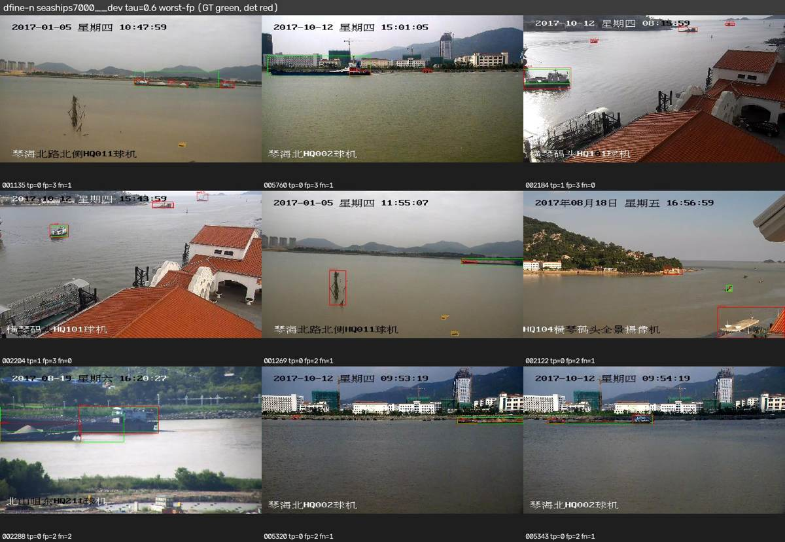
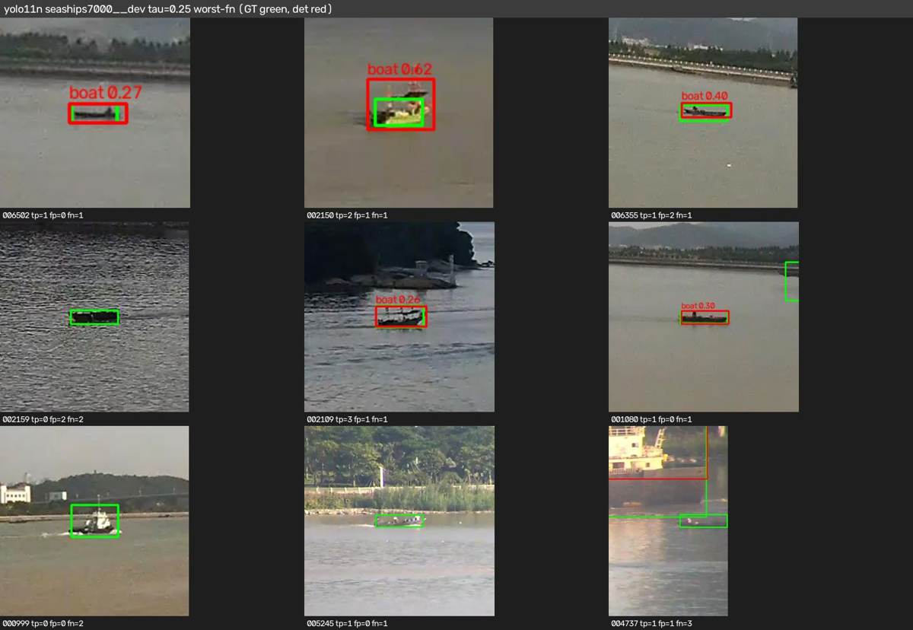
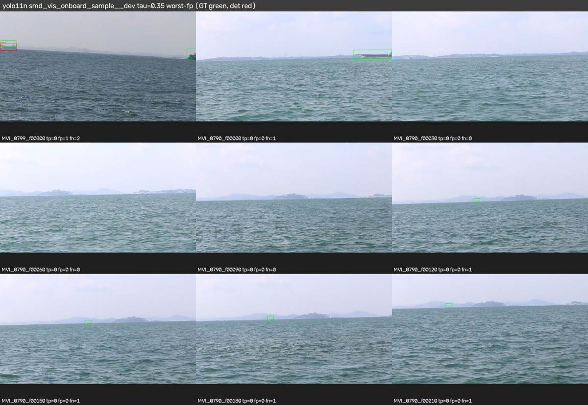
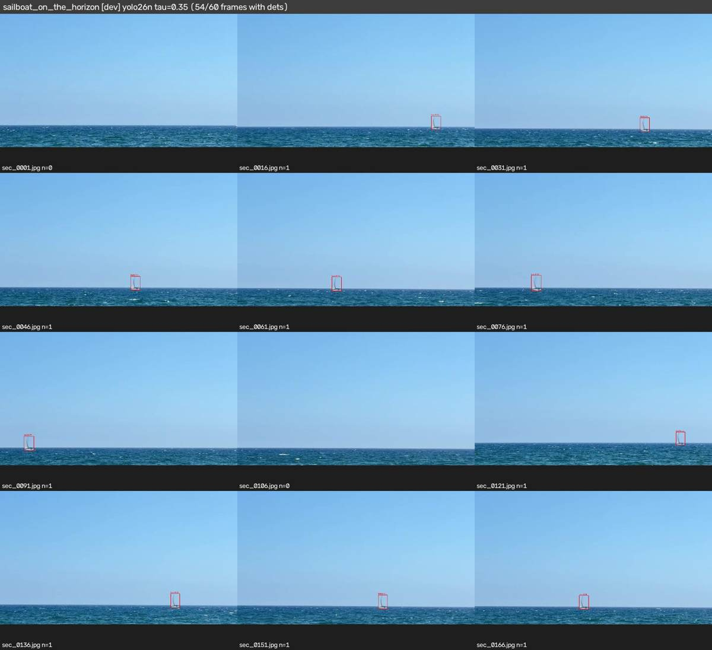
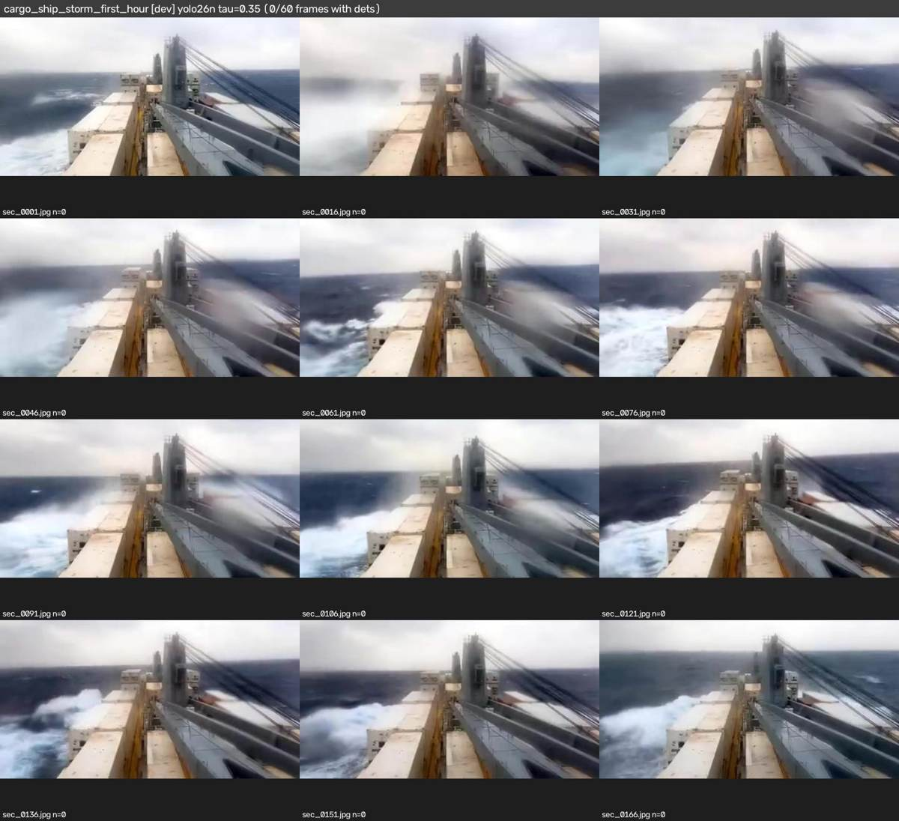
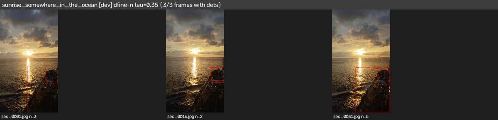
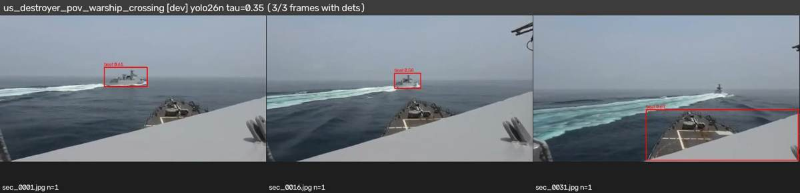

# Workstream B — zero-shot detector benchmark (RGB, GPU accuracy + GPU latency)

**Question.** Which existing pretrained detectors are usable on maritime imagery *without fine-tuning*, and what do
input size and horizon-band tiling buy for small/far contacts? Everything is behind the `Detector` adapter
(CONTRACTS §2) in `edgeml/src/edgeml/detectors/`; native labels are kept and mapped to a class-agnostic
`vessel` / `object` label (`detectors/labels.py`).

Phase-1 scope: RGB only (IR skipped), no fine-tuning, no tracking/sightings (Workstream C) — but the metrics below are
chosen for the sightings problem: recall by box area (far contacts) and **false positives per sea-only frame**
(every FP on an empty-sea frame becomes a false sighting downstream).

All numbers in this report come from `metrics.json` files under
`gs://qwiklabs-gcp-02-34a870014566-ghost-seeker/edgeml/runs/<run-id>/` (run ids listed in §8); tables were rendered
with `edgeml/tools/report_tables.py`. "Verified" = measured in those runs; "inferred" is marked as such.

## 1. TL;DR / shortlist

**Shortlist (zero-shot, for the CPU laptop; ranked by test AP50 at equal cost):**

| pick | why | test AP50 SeaShips / SMD-onboard (640) | L4 ms | params |
|---|---|---|---|---|
| **1. D-FINE-N** (`dfine-n`, 3.8 M) | best accuracy per parameter of anything that can run on the laptop: beats every YOLO ≤ 11 M on both test sets, no NMS, exported to ONNX; cost is 4–5× a YOLO-nano on the L4 (DETR decoder) — D must confirm CPU ms | 0.633 / 0.877 | 62 | 3.8 M |
| **2. YOLO26n** (`yolo26n`, 2.6 M) | best nano YOLO (+0.06 AP50 over YOLO11n on SeaShips test, +0.08 on SMD dev at 960), NMS-free end-to-end head → simplest CPU post-processing, cheapest real-time option | 0.519 / 0.814 (0.797 @960) | 15 | 2.6 M |
| **3. YOLO26s / YOLOv8s** (`yolo26s`, 10 M) | the "small" tier if the laptop budget allows ~4× YOLO-nano FLOPs: +0.07 AP50 over YOLO26n on SeaShips, +0.05 on SMD, still 15 ms on the L4 | 0.589 / 0.866 | 15 | 10 M |
| upper bound / teacher | **RT-DETRv2-R18** (20 M, 0.671 / 0.896) is the best realistic model; **OWLv2-B/16** (155 M, 0.689 / 0.843, 330 ms) only matches it and is for pseudo-labelling, **not** the laptop | | | |

Drop: NanoDet-Plus (0.28 / 0.65), YOLOX-tiny (fastest but 0.42 / 0.75), Grounding DINO-T (worse than YOLO11n and 0.76 FP per
empty-sea frame), YOLO-World-S (open vocabulary did not beat COCO `boat`: 0.480 / 0.735 behind YOLO26s; keep only if
non-vessel prompts — buoy, person, submarine — are needed). YOLO11n is a fine fallback (0.461 / 0.808, 13 ms) if YOLO26's
newer runtime is a problem for D.

**Settings:** 640 px full frame by default; **960 px for the on-board camera** (+0.03–0.08 AP50 on SMD for the nano
models, 1280 hurts; SeaShips-style shore CCTV of large ships gets worse at anything above 640). Operating thresholds
τ per model are in `taus640.json` / `taus960.json` in the run dirs (dev-chosen, test-frozen). Horizon-band tiling
(full frame + 2–3 tiles in a ±10 % band) gave **no measurable gain** on the labelled sets at 3–4× cost and is shipped
default-off; the labelled sets have essentially no sub-32² px targets, so this is "not shown", not "shown useless".

**Verified vs inferred.** All AP / recall / FP / latency numbers are measured (runs in §10). Params come from the
libraries. Everything about the laptop (CPU ms, INT8) is Workstream D's to measure from the exports in §9 — the L4
latencies here only rank models. The Singapore Maritime catalog GT is mis-joined (root-caused in §7, not fixed), so
it is excluded from every conclusion.

## 2. Setup

| item | value |
|---|---|
| GPU VM | `edgeml-b-l4`, g2-standard-4 (1× NVIDIA L4, 4 vCPU), us-central1-a, Deep Learning VM image (`g2-standard-8` was stocked out) |
| software | torch 2.x CUDA, ultralytics 8.3.x, transformers 4.5x, onnxruntime 1.2x, faster-coco-eval (COCO AP), see `edgeml/pyproject.toml` |
| precision | fp16 for Ultralytics models on GPU, fp32 for HF (RT-DETRv2, D-FINE, OWLv2, Grounding DINO) and ONNX-Runtime models (YOLOX-tiny, NanoDet-Plus, CUDA EP) |
| latency | wall-clock of `Detector.detect()` per frame incl. preprocessing/postprocessing, batch 1, median over the set (`ms_p50`); **GPU numbers, not the laptop** — Workstream D measures CPU ms from the ONNX exports |
| catalog | `~/data/catalog/*.jsonl` mirror of the BigQuery `ghost_fleet` tables (pulled 2026-11-04), images mirrored to `~/data/datasets/...` |

### Candidates (all zero-shot)

| adapter name | family | weights | train data | params (M) | tier | notes |
|---|---|---|---|---|---|---|
| yolov8n / yolov8s | Ultralytics YOLOv8 | `yolov8{n,s}.pt` | COCO | 3.2 / 11.2 | nano / small | COCO `boat` |
| yolo11n / yolo11s / yolo11m | Ultralytics YOLO11 | `yolo11{n,s,m}.pt` | COCO | 2.6 / 9.4 / 20.1 | nano / small / med | literature pick |
| yolo26n / yolo26s | Ultralytics YOLO26 | `yolo26{n,s}.pt` | COCO | 2.4 / 9.5 | nano / small | NMS-free head; literature pick |
| yolox-tiny | YOLOX (Megvii ONNX) | `yolox_tiny.onnx` 416² | COCO | 5.1 | tiny | raw head output, decode in adapter |
| nanodet-plus | NanoDet-Plus-m 416 (ONNX) | `nanodet-plus-m_416.onnx` | COCO | 1.2 | tiny | |
| dfine-n / dfine-s | D-FINE (HF `ustc-community/dfine-{nano,small}-coco`) | HF | COCO | 3.8 / 10.2 | nano / small | DETR-style, no NMS; literature pick |
| rtdetrv2-r18 | RT-DETRv2 (HF `PekingU/rtdetr_v2_r18vd`) | HF | COCO | 20 | medium | |
| rtdetr-l | RT-DETR-L (Ultralytics) | `rtdetr-l.pt` | COCO | 32 | large | |
| yolov8s-world | YOLO-World-S (Ultralytics) | `yolov8s-worldv2.pt` | O365+GoldG+CC3M | 12.7 | small | prompts: ship, boat, sailboat, ferry, cargo ship, fishing boat, speedboat, kayak, warship, submarine, vessel, buoy, person |
| owlv2-b16 | OWLv2 B/16 (HF `google/owlv2-base-patch16-ensemble`) | HF | WebLI + O365/VG | 154 | **heavy, teacher/upper-bound only** | same prompts; ~380 ms/frame on the L4 → will not run on the laptop |
| gdino-t | Grounding DINO-T (HF `IDEA-Research/grounding-dino-tiny`) | HF | O365+GoldG+Cap4M | 172 | **heavy, teacher only** | same prompts |
| argus-yolov8s / argus-yolo11l | maritime-pretrained YOLO (public "Argus" checkpoints) | HF | Roboflow marine surveillance **+ SeaShips** | 11.1 / 25.3 | small / large | **trained on SeaShips → excluded from SeaShips tables**; shown on SMD only |

Params are Ultralytics/HF reported values (verified for the Ultralytics models via `model.info()`, inferred from model
cards for the others); GFLOPs are not reported because the adapters' `info()` only has them for Ultralytics models.

### Eval sets (catalog state 2026-11-04, see `edgeml/configs/splits.yaml`)

| set | split used | images (stride) | GT boxes | notes |
|---|---|---|---|---|
| SeaShips 7000 | dev = upstream train+valid (3500); **test = upstream test (3500)** | dev stride 5 → 700; test stride 2 → 1750 | ~1.3 boxes/img, 6 ship classes | fixed shore CCTV, 1920×1080, mostly medium/large ships |
| SMD VIS onboard sample | dev = MVI_0790, MVI_0799; **test = MVI_0797, MVI_0801** | 40 / 40 frames | 27 dev GT (6 medium, 21 large, 0 < 32² px), 75 test GT | the only on-board labelled set; horizon GT available |
| Singapore Maritime (HF COCO) | — | 1981 imgs / 112k boxes in catalog | **GT unusable, see §7** | excluded from selection; dev numbers shown for completeness |
| unlabeled 1-fps clips | qualitative | 7 clips, every 15th frame, ≤60 frames | none | glare, whitecaps, own-ship structure, tiny horizon targets |

Recall buckets: the code keeps COCO-style tiny (<16²) / small (16²–32²) / medium (32²–96²) / large (>96²) buckets; the
tables merge tiny+small into **"<32²"** as asked in `literature.md` and print the GT count per bucket because the
labelled sets have very few sub-32² boxes (SMD dev: 0, SeaShips dev: 1).

Threshold protocol: every model is run at score ≥ 0.05; AP is threshold-free; the operating threshold τ is chosen per
model and per dataset on **dev** (max F1 of class-agnostic vessel matching at IoU 0.5) and then frozen
(`~/taus640.json`, `~/taus960.json`, copied to the run dirs) for the single test pass.

## 3. Dev leaderboard (640 px, full frame)

Run `20261104-b-dev640`, every model at 640 px (YOLOX/NanoDet at their native 416), full frame, class-agnostic
"vessel" matching (GT ship/boat/vessel classes vs detections whose native label maps to `vessel`). AP = COCO
AP@[.5:.95]; R@τ = recall at the dev-chosen operating threshold; "R med/large" = recall at τ for 32²–96² / >96² px GT
(SeaShips dev has 1 sub-32² box, SMD dev 0, so the <32² bucket is empty — see §5/§6 for what that means). Sorted by
SeaShips AP50 + SMD AP50. Argus rows are maritime-trained (SeaShips in their training set) and are not scored on
SeaShips. Singapore columns are in the full table in GCS (`metrics.json`) and are ≈0.08 AP50 for every model (§7).

| model | params M | L4 ms p50 | SeaShips AP50 | AP | R@τ | R med/large | SMD AP50 | AP | R@τ | R med/large | SMD FP/sea-only frame |
|---|---|---|---|---|---|---|---|---|---|---|---|
| rtdetrv2-r18 | 20.2 | 55.4 | 0.654 | 0.367 | 0.61@0.65 | 0.68/0.61 | 0.794 | 0.412 | 0.70@0.50 | 0.00/0.90 | 0.00 |
| rtdetr-l | 33.0 | 42.0 | 0.697 | 0.414 | 0.63@0.60 | 0.76/0.61 | 0.733 | 0.412 | 0.70@0.50 | 0.17/0.86 | 0.00 |
| owlv2-b16 | 155.0 | 376.3 | 0.660 | 0.375 | 0.64@0.50 | 0.79/0.62 | 0.713 | 0.320 | 0.74@0.40 | 0.17/0.90 | 0.00 |
| dfine-s | 10.3 | 68.7 | 0.656 | 0.373 | 0.58@0.65 | 0.56/0.58 | 0.691 | 0.424 | 0.63@0.60 | 0.00/0.81 | 0.00 |
| dfine-n | 3.8 | 62.4 | 0.613 | 0.334 | 0.56@0.60 | 0.67/0.55 | 0.723 | 0.415 | 0.67@0.50 | 0.00/0.86 | 0.00 |
| yolo26s | 10.0 | 14.9 | 0.569 | 0.331 | 0.55@0.35 | 0.51/0.55 | 0.644 | 0.370 | 0.63@0.35 | 0.00/0.81 | 0.00 |
| yolo11s | 9.5 | 13.3 | 0.506 | 0.276 | 0.49@0.35 | 0.60/0.48 | 0.699 | 0.393 | 0.67@0.30 | 0.17/0.81 | 0.00 |
| yolo26n | 2.6 | 14.9 | 0.506 | 0.271 | 0.49@0.20 | 0.56/0.49 | 0.641 | 0.359 | 0.63@0.25 | 0.00/0.81 | 0.00 |
| yolov8s | 11.2 | 10.9 | 0.564 | 0.316 | 0.56@0.30 | 0.49/0.56 | 0.571 | 0.393 | 0.59@0.45 | 0.00/0.76 | 0.00 |
| yolo11n | 2.6 | 13.2 | 0.451 | 0.251 | 0.47@0.25 | 0.58/0.46 | 0.639 | 0.384 | 0.59@0.35 | 0.00/0.76 | 0.00 |
| yolov8s-world | 12.8 | 14.7 | 0.478 | 0.287 | 0.46@0.45 | 0.58/0.44 | 0.609 | 0.345 | 0.63@0.45 | 0.17/0.76 | 0.00 |
| yolox-tiny | 5.1 | 5.8 | 0.400 | 0.198 | 0.45@0.25 | 0.39/0.45 | 0.621 | 0.306 | 0.63@0.15 | 0.00/0.81 | 0.00 |
| yolov8n | 3.2 | 10.8 | 0.377 | 0.210 | 0.40@0.20 | 0.43/0.40 | 0.592 | 0.332 | 0.59@0.15 | 0.17/0.71 | 0.00 |
| gdino-t | 172.3 | 217.6 | 0.442 | 0.256 | 0.42@0.35 | 0.67/0.39 | 0.433 | 0.267 | 0.70@0.30 | 0.00/0.90 | 0.76 |
| nanodet-plus | 2.4 | 13.8 | 0.291 | 0.114 | 0.32@0.30 | 0.32/0.32 | 0.322 | 0.169 | 0.26@0.35 | 0.00/0.33 | 0.00 |
| argus-yolov8s | 11.1 | 10.9 | – | – | – | – | 0.825 | 0.358 | 0.85@0.60 | 0.67/0.90 | 0.06 |
| argus-yolo11l | 25.3 | 22.6 | – | – | – | – | 0.692 | 0.201 | 0.63@0.65 | 0.00/0.81 | 0.00 |

Reading it:
- **Zero-shot COCO `boat` is usable but far from solved**: the best COCO detectors reach 0.65–0.70 AP50 on SeaShips
  and 0.72–0.79 on SMD; the nano edge models sit at 0.45–0.51 (SeaShips) / 0.64 (SMD).
- **DETR-family models beat YOLOs at equal params** zero-shot: D-FINE-N (3.8 M) ≈ YOLO26s/YOLOv8s (10–11 M) on
  SeaShips and beats every YOLO on SMD AP; RT-DETRv2-R18 is the best realistic model but 20 M params / 55 ms on an L4.
- **Among nano edge models YOLO26n > YOLO11n > YOLOv8n** (0.506 / 0.451 / 0.377 SeaShips AP50) at the same cost;
  YOLOX-tiny is the fastest (5.8 ms) but weakest of the usable ones; NanoDet-Plus is not usable zero-shot (0.29 / 0.32).
- **Open-vocabulary models do not beat closed-set COCO `boat` here**: YOLO-World-S with 13 maritime prompts is below
  YOLO26s on both sets; OWLv2 (155 M, 376 ms) only matches RT-DETR-L; Grounding DINO-T is worse than YOLO11n and
  produces 0.76 FP per sea-only frame on SMD (prompts fire on wakes/horizon) — the one model with a real
  false-sighting problem. OWLv2 is kept only as a **teacher / upper bound** for pseudo-labelling; neither runs on
  the laptop.
- **FP on sea-only frames** (frames with no GT; 16 of the 40 SMD dev frames) is 0.00 for every COCO model at its
  dev τ — glare/whitecaps in the SMD dev videos do not trigger COCO `boat`; the qualitative clips in §8 are the
  harder test (storm whitecaps, sun glare, own-ship structure).
- The maritime-pretrained Argus YOLOv8s (0.825 SMD AP50 at 11 ms) shows what in-domain training buys over zero-shot
  (+0.13 AP50 over the best 10 M COCO model) — the argument for phase-2 fine-tuning on the same adapters.

## 4. Input-size sweep (dev)

Runs `20261104-b-dev960`, `20261104-b-dev1280` (same frames, same models, τ re-chosen per run). Cells are
AP50 / AP / R@τ / R<32² / R_medium / FP per sea-only frame / L4 ms p50.

**SeaShips dev** (shore CCTV, stride 5 = 700 frames)
| model | 640: AP50 / AP / R@τ / R<32² / R_med / FP-sea / ms | 960: AP50 / AP / R@τ / R<32² / R_med / FP-sea / ms | 1280: AP50 / AP / R@τ / R<32² / R_med / FP-sea / ms |
|---|---|---|---|
| dfine-n | 0.613 / 0.334 / 0.56 / – / 0.67 / – / 62.4 | 0.483 / 0.260 / 0.44 / – / 0.56 / – / 67.4 | 0.183 / 0.086 / 0.29 / – / 0.49 / – / 74.3 |
| rtdetrv2-r18 | 0.654 / 0.367 / 0.61 / – / 0.68 / – / 55.4 | 0.498 / 0.265 / 0.47 / – / 0.62 / – / 60.0 | 0.257 / 0.124 / 0.34 / – / 0.43 / – / 66.8 |
| yolo11n | 0.451 / 0.251 / 0.47 / – / 0.58 / – / 13.2 | 0.443 / 0.239 / 0.48 / – / 0.58 / – / 13.8 | 0.367 / 0.198 / 0.37 / – / 0.46 / – / 16.1 |
| yolo11s | 0.506 / 0.276 / 0.49 / – / 0.60 / – / 13.3 | 0.479 / 0.263 / 0.50 / – / 0.62 / – / 13.8 | 0.413 / 0.228 / 0.41 / – / 0.60 / – / 16.0 |
| yolo26n | 0.506 / 0.271 / 0.49 / – / 0.56 / – / 14.9 | 0.512 / 0.286 / 0.52 / – / 0.64 / – / 15.3 | 0.437 / 0.229 / 0.43 / – / 0.62 / – / 17.6 |
**SMD onboard dev** (40 frames, 27 GT)
| model | 640: AP50 / AP / R@τ / R<32² / R_med / FP-sea / ms | 960: AP50 / AP / R@τ / R<32² / R_med / FP-sea / ms | 1280: AP50 / AP / R@τ / R<32² / R_med / FP-sea / ms |
|---|---|---|---|
| argus-yolov8s | 0.825 / 0.358 / 0.85 / – / 0.67 / 0.06 / 10.9 | 0.859 / 0.398 / 0.89 / – / 0.83 / 0.18 / 11.5 | 0.803 / 0.402 / 0.78 / – / 0.50 / 0.12 / 13.5 |
| dfine-n | 0.723 / 0.415 / 0.67 / – / 0.00 / 0.00 / 61.9 | 0.769 / 0.440 / 0.78 / – / 0.33 / 0.12 / 66.4 | 0.545 / 0.289 / 0.44 / – / 0.00 / 0.00 / 73.6 |
| rtdetrv2-r18 | 0.794 / 0.412 / 0.70 / – / 0.00 / 0.00 / 55.4 | 0.816 / 0.429 / 0.81 / – / 0.67 / 0.12 / 59.6 | 0.726 / 0.432 / 0.56 / – / 0.00 / 0.00 / 66.6 |
| yolo11n | 0.639 / 0.384 / 0.59 / – / 0.00 / 0.00 / 12.9 | 0.643 / 0.388 / 0.67 / – / 0.17 / 0.00 / 13.6 | 0.652 / 0.366 / 0.52 / – / 0.00 / 0.00 / 16.0 |
| yolo11s | 0.699 / 0.393 / 0.67 / – / 0.17 / 0.00 / 13.1 | 0.732 / 0.423 / 0.74 / – / 0.17 / 0.00 / 13.7 | 0.731 / 0.406 / 0.67 / – / 0.17 / 0.00 / 15.8 |
| yolo26n | 0.641 / 0.359 / 0.63 / – / 0.00 / 0.00 / 14.9 | 0.721 / 0.426 / 0.67 / – / 0.00 / 0.00 / 15.1 | 0.711 / 0.424 / 0.67 / – / 0.17 / 0.00 / 17.5 |

- **SeaShips (large ships, 1920×1080 shore CCTV): bigger input hurts every model**, drastically for the DETRs
  (D-FINE-N 0.61 → 0.48 → 0.18; RT-DETRv2 0.65 → 0.50 → 0.26). They were trained at a fixed 640 px and their
  position embeddings / query priors do not transfer to 1280 px; the YOLOs degrade gently (−0.01 to −0.08 at 960,
  −0.08 to −0.14 at 1280).
- **SMD onboard (small/medium vessels near the horizon): 960 helps** — YOLO26n +0.08 AP50 (0.64 → 0.72), D-FINE-N
  +0.05, RT-DETRv2 +0.02, YOLO11n ±0; 1280 gives nothing more for YOLO and breaks the DETRs again.
- GPU cost of 960 is small on the L4 (+5–10%, the GPU is not saturated at batch 1); on the laptop CPU expect ~2.25×
  the 640 cost (pixels), which is why **960 only for the on-board camera, 640 default** is the recommendation, and
  Workstream D should measure both.

## 5. Horizon-band tiling (dev)

Implemented in `detectors/tiled.py`: `HorizonBandDetector` = one full-frame pass + `n` tiles across a band of
height `band_frac·H` (0.2 = ±10%) centred on the horizon (catalog GT horizon when `--horizon-gt`, otherwise a
gradient-row estimate), merged with class-agnostic NMS; `TiledDetector` = SAHI-style full grid of `tile`-px tiles
(+ full frame). Runs `20261104-b-dev640-hband20x3`, `-hband20x3-gth`, `-hband20x2`, `-sahi640`.

**SeaShips dev** (no horizon in a shore-CCTV frame → band = middle 20% of the image)
| model | full640: AP50 / AP / R@τ / R<32² / R_med / FP-sea / ms | hband3: AP50 / AP / R@τ / R<32² / R_med / FP-sea / ms | hband3gt: AP50 / AP / R@τ / R<32² / R_med / FP-sea / ms | hband2: AP50 / AP / R@τ / R<32² / R_med / FP-sea / ms | sahi640: AP50 / AP / R@τ / R<32² / R_med / FP-sea / ms |
|---|---|---|---|---|---|
| dfine-n | 0.613 / 0.334 / 0.56 / – / 0.67 / – / 62.4 | 0.495 / 0.264 / 0.46 / – / 0.57 / – / 208.2 | – | 0.570 / 0.305 / 0.54 / – / 0.65 / – / 159.6 | 0.375 / 0.193 / 0.47 / – / 0.58 / – / 421.5 |
| rtdetrv2-r18 | 0.654 / 0.367 / 0.61 / – / 0.68 / – / 55.4 | 0.571 / 0.310 / 0.49 / – / 0.42 / – / 185.1 | – | – | – |
| yolo11n | 0.451 / 0.251 / 0.47 / – / 0.58 / – / 13.2 | 0.337 / 0.177 / 0.42 / – / 0.53 / – / 53.6 | – | 0.416 / 0.222 / 0.45 / – / 0.57 / – / 42.1 | 0.206 / 0.093 / 0.40 / – / 0.46 / – / 109.6 |
| yolo11s | 0.506 / 0.276 / 0.49 / – / 0.60 / – / 13.3 | 0.374 / 0.195 / 0.49 / – / 0.61 / – / 54.1 | – | – | – |
| yolo26n | 0.506 / 0.271 / 0.49 / – / 0.56 / – / 14.9 | 0.396 / 0.199 / 0.44 / – / 0.42 / – / 59.6 | – | 0.468 / 0.241 / 0.52 / – / 0.62 / – / 46.2 | 0.249 / 0.116 / 0.45 / – / 0.57 / – / 126.5 |
**SMD onboard dev** (`hband3gt` uses the catalog GT horizon, the others estimate it from the image)
| model | full640: AP50 / AP / R@τ / R<32² / R_med / FP-sea / ms | hband3: AP50 / AP / R@τ / R<32² / R_med / FP-sea / ms | hband3gt: AP50 / AP / R@τ / R<32² / R_med / FP-sea / ms | hband2: AP50 / AP / R@τ / R<32² / R_med / FP-sea / ms | sahi640: AP50 / AP / R@τ / R<32² / R_med / FP-sea / ms |
|---|---|---|---|---|---|
| argus-yolov8s | 0.825 / 0.358 / 0.85 / – / 0.67 / 0.06 / 10.9 | 0.810 / 0.370 / 0.78 / – / 0.33 / 0.00 / 45.5 | 0.810 / 0.316 / 0.78 / – / 0.33 / 0.00 / 43.8 | – | – |
| dfine-n | 0.723 / 0.415 / 0.67 / – / 0.00 / 0.00 / 61.9 | 0.711 / 0.372 / 0.63 / – / 0.00 / 0.00 / 207.1 | 0.694 / 0.330 / 0.63 / – / 0.00 / 0.00 / 197.7 | 0.785 / 0.402 / 0.74 / – / 0.17 / 0.06 / 156.7 | 0.729 / 0.411 / 0.70 / – / 0.17 / 0.00 / 411.1 |
| rtdetrv2-r18 | 0.794 / 0.412 / 0.70 / – / 0.00 / 0.00 / 55.4 | 0.686 / 0.400 / 0.59 / – / 0.00 / 0.00 / 179.4 | 0.701 / 0.380 / 0.67 / – / 0.00 / 0.06 / 168.1 | – | – |
| yolo11n | 0.639 / 0.384 / 0.59 / – / 0.00 / 0.00 / 12.9 | 0.583 / 0.362 / 0.59 / – / 0.00 / 0.00 / 52.6 | 0.568 / 0.276 / 0.56 / – / 0.00 / 0.00 / 50.3 | 0.645 / 0.389 / 0.63 / – / 0.00 / 0.00 / 40.6 | 0.695 / 0.368 / 0.63 / – / 0.00 / 0.00 / 105.3 |
| yolo11s | 0.699 / 0.393 / 0.67 / – / 0.17 / 0.00 / 13.1 | 0.704 / 0.371 / 0.74 / – / 0.17 / 0.00 / 53.8 | 0.704 / 0.307 / 0.74 / – / 0.17 / 0.00 / 51.9 | – | – |
| yolo26n | 0.641 / 0.359 / 0.63 / – / 0.00 / 0.00 / 14.9 | 0.679 / 0.382 / 0.67 / – / 0.00 / 0.00 / 59.4 | 0.684 / 0.303 / 0.67 / – / 0.00 / 0.00 / 56.7 | 0.683 / 0.353 / 0.67 / – / 0.00 / 0.00 / 45.4 | 0.667 / 0.364 / 0.67 / – / 0.00 / 0.00 / 120.9 |

- **No measurable gain from tiling on the labelled dev sets, at 3–8× the cost.** Full-grid SAHI is clearly harmful on
  SeaShips (large ships get cut across tiles and duplicate/partial boxes survive NMS: YOLO11n 0.45 → 0.21) and
  neutral on SMD. The horizon band with 3 tiles is −0.05 to −0.12 AP50 on SeaShips and −0.01 to −0.11 on SMD for
  most models; 2 wider tiles is the least harmful variant (YOLO26n/D-FINE-N +0.04/+0.06 on SMD, −0.04 on SeaShips).
  Using the GT horizon instead of the estimate changes nothing, so the estimator is not the problem.
- **Why this is not the final word**: the two labelled sets contain essentially **no sub-32² px targets**
  (SeaShips dev: 1 of 905 GT; SMD dev: 0 of 27) — the case tiling exists for cannot be measured on them. The
  qualitative clips (§8, e.g. `Sailboat_on_the_horizon`) do contain such targets. Recommendation: keep
  `HorizonBandDetector` behind the adapter, default **off**, and re-evaluate once a tiny-target labelled set exists
  (Singapore re-ingest §7, or the full SMD on-board set).
- CPU ms for the tiling variants are Workstream D's measurement (E4); the L4 numbers scale ~linearly with the number
  of passes (hband2 ≈ 3×, hband3 ≈ 4×, sahi640 on 1080p ≈ 8× the single pass).

## 6. Locked test sets (one pass, τ frozen from dev)

Runs `20261104-b-test640` (SeaShips upstream test, 3,500 frames at stride 2 = 1,750 scored, 4,683 GT; SMD videos
MVI_0797 + MVI_0801, 40 frames, 72 GT) and `20261104-b-test960` (SMD test at 960 px, edge models + RT-DETRv2).
Each model was run **once** with τ frozen from dev (`taus640.json`, `taus960.json`). R@τ shows the frozen τ.
Grounding DINO was dropped before test (dev FP rate); Argus is maritime-trained and only scored on SMD.
SeaShips test has 9 sub-32² boxes (so the <32² recall there is anecdotal) and no sea-only frames; SMD test has no
sea-only frames either (every frame has a vessel), hence the "–" FP column — the sea-only FP evidence is the SMD dev
set (§3) and the clips (§8).

| model | params M | L4 ms p50 | SeaShips AP50 | AP | R@τ | R <32²/med/large | SMD AP50 | AP | R@τ | R <32²/med/large | SMD FP/sea-only frame | SMD@960 AP50 | AP |
|---|---|---|---|---|---|---|---|---|---|---|---|---|---|
| rtdetr-l | 33.0 | 42.2 | 0.717 | 0.431 | 0.63@0.60 | 0.56/0.70/0.62 | 0.878 | 0.507 | 0.82@0.50 | –/0.45/0.96 | – | – | – |
| rtdetrv2-r18 | 20.2 | 55.3 | 0.671 | 0.384 | 0.63@0.65 | 0.56/0.67/0.62 | 0.896 | 0.490 | 0.81@0.50 | –/0.55/0.90 | – | 0.881 | 0.458 |
| dfine-s | 10.3 | 65.2 | 0.657 | 0.380 | 0.58@0.65 | 0.56/0.63/0.58 | 0.885 | 0.498 | 0.75@0.60 | –/0.30/0.92 | – | – | – |
| owlv2-b16 | 155.0 | 327.1 | 0.689 | 0.398 | 0.65@0.50 | 0.89/0.81/0.64 | 0.843 | 0.476 | 0.83@0.40 | –/0.50/0.96 | – | – | – |
| dfine-n | 3.8 | 62.2 | 0.633 | 0.346 | 0.58@0.60 | 0.44/0.71/0.57 | 0.877 | 0.499 | 0.79@0.50 | –/0.45/0.92 | – | 0.726 | 0.385 |
| yolo26s | 10.0 | 15.0 | 0.589 | 0.340 | 0.56@0.35 | 0.67/0.58/0.55 | 0.866 | 0.485 | 0.79@0.35 | –/0.45/0.92 | – | – | – |
| yolov8s | 11.2 | 11.0 | 0.591 | 0.330 | 0.57@0.30 | 0.33/0.54/0.57 | 0.842 | 0.477 | 0.76@0.45 | –/0.40/0.90 | – | – | – |
| yolo26n | 2.6 | 14.9 | 0.519 | 0.285 | 0.51@0.20 | 0.22/0.57/0.50 | 0.814 | 0.451 | 0.64@0.25 | –/0.05/0.87 | – | 0.797 | 0.443 |
| yolo11s | 9.5 | 13.4 | 0.508 | 0.283 | 0.49@0.35 | 0.44/0.63/0.48 | 0.819 | 0.479 | 0.76@0.30 | –/0.40/0.90 | – | 0.829 | 0.470 |
| yolo11n | 2.6 | 13.2 | 0.461 | 0.257 | 0.48@0.25 | 0.33/0.62/0.46 | 0.808 | 0.456 | 0.71@0.35 | –/0.25/0.88 | – | 0.848 | 0.473 |
| yolov8s-world | 12.8 | 15.1 | 0.480 | 0.279 | 0.45@0.45 | 0.67/0.57/0.43 | 0.735 | 0.431 | 0.71@0.45 | –/0.20/0.90 | – | – | – |
| yolox-tiny | 5.1 | 5.9 | 0.418 | 0.204 | 0.45@0.25 | 0.11/0.46/0.45 | 0.745 | 0.389 | 0.71@0.15 | –/0.20/0.90 | – | – | – |
| nanodet-plus | 2.4 | 14.0 | 0.281 | 0.113 | 0.29@0.30 | 0.00/0.28/0.29 | 0.650 | 0.300 | 0.49@0.35 | –/0.15/0.62 | – | – | – |
| argus-yolov8s | 11.1 | 10.9 | – | – | – | – | 0.796 | 0.436 | 0.83@0.60 | –/0.60/0.92 | – | 0.780 | 0.453 |

- Test confirms dev ordering: RT-DETR-L > RT-DETRv2-R18 ≈ OWLv2 > D-FINE-S ≈ D-FINE-N > YOLO26s ≈ YOLOv8s > YOLO26n >
  YOLO11s > YOLO-World-S ≈ YOLO11n > YOLOX-tiny > NanoDet-Plus. No model's test AP50 is more than 0.04 from its dev
  AP50 on SeaShips (dev-tuned τ carried over without a precision collapse: P@τ 0.65–0.73 on SeaShips test).
- SMD test (0.81–0.90 AP50) is easier than SMD dev (0.64–0.79): the test videos have larger, closer vessels
  (52 of 72 GT > 96² px). The spread between models is correspondingly small there; **SeaShips test is the
  discriminating set**.
- 960 px on SMD test: YOLO11n +0.04, YOLO11s +0.01, RT-DETRv2 −0.02, YOLO26n −0.02, D-FINE-N −0.15 (!). The dev gain
  for D-FINE-N at 960 (+0.05) did not hold — treat 960 as a YOLO-only option and keep D-FINE at its native 640.
- Argus YOLOv8s (maritime-trained) loses its dev advantage on SMD test (0.796 vs 0.877 for zero-shot D-FINE-N):
  its training data does not cover this camera; it is not a shortcut around proper fine-tuning.

## 7. Singapore Maritime catalog: image↔annotation mis-join (for the catalog owner)

**Symptom.** Every detector scores vessel AP50 ≈ 0.08 on `singapore_maritime` (vs 0.45–0.70 on SeaShips and 0.6–0.8 on
SMD) and the FP sheets show GT boxes on empty sky/sea. The catalog has 1,981 images but 112,118 boxes (56/img;
`train/3` has 277 boxes, `train/0` 238).

**Cause (verified against the raw parquet in `gs://…/raw/singapore_maritime/data/`).** The HF source
(`ARG-NCTU/Singapore_Maritime_Dataset_coco`, rev `5520b959`) has 13,410 rows (train 9,387 / validation 2,682 / test
1,341). Its `image_id` column is the COCO id *inside each original per-video annotation file*, so it restarts per
video and collides across videos: the test parquet has 1,341 rows but only **530 distinct `image_id`s**
(163 ids occur once, 147 twice, … 4 ids eight times); train 9,387 rows → 815 ids; validation 2,682 → 636 ids.
`datasets/ingest/hf_dataset.py` used `image_id` as the image key: it wrote the image as
`datasets/singapore_maritime/images/<split>/<image_id>.jpg` (last row wins) and emitted **every** colliding row's
`objects` under `image_id = singapore_maritime/<split>/<image_id>` in `annotations` — so the catalog contains the union
of all rows' boxes on one surviving image. The row count matches: 1,981 catalog images = 530 + 815 + 636 distinct ids;
112,118 catalog boxes = all 13,410 rows' objects.

**Example.** `singapore_maritime/test/121` carries 19 boxes = test row 87 (13 boxes, annotation ids 111429–111441)
+ test row 995 (6 boxes, annotation ids 28466–28471); only one of the two frames is on disk. Images whose `image_id`
occurs once (e.g. `test/298`, 4 boxes) are correct — 470 of 1,981 images (24%) have a single contiguous annotation-id
block and are plausibly clean.

**Correct key.** Each row has `image.path` = `<video>_frame_<n>.jpg` (e.g. `MVI_1474_VIS_frame_000324.jpg`,
`MVI_1452_VIS_Haze_frame_000288.jpg`), which is unique and also gives the **source video for the by-video split
rule**. Re-ingest keyed on `image.path` (or `(split, row_index)`), keep `image_id` only as an attribute, and expect
13,410 images / 112,118 boxes. Not fixed here (ingest is owned by the data workstream); Singapore is excluded from
model selection in this report.

## 8. Failure modes (contact sheets)

Worst-FP / worst-FN sheets for every (model, set) are in `gs://…/edgeml/runs/20261104-b-dev640/sheets/`
(GT green, vessel detections red, other COCO classes orange). Qualitative clip sheets + per-frame detections are in
`gs://…/edgeml/runs/20261104-b-clips/` (`<clip>__<model>.jpg|.jsonl`, `summary.json`). Small copies of the ones
discussed here are committed under `edgeml/reports/B/`.

**What the labelled-set failures actually are** (dev sheets; same picture for every model):

- *SeaShips "false positives" are largely unlabelled or partially-visible vessels* — moored boats along the far quay,
  a vessel cut by the frame edge, or one GT box spanning two ships (D-FINE-N worst-FP sheet below: 7 of 9 tiles).
  Real FPs: a dead tree/snag in the river, pier and roof structures, the *own camera housing* (own-ship-structure
  analogue). SeaShips precision numbers are therefore pessimistic; the ranking is unaffected.
- *SeaShips misses* are (a) small, low-contrast boats far down-river at 640 px (the <32²/medium bucket, recall 0.5–0.7),
  (b) localisation misses — a detection exists but IoU < 0.5 because the model boxes the hull+wake or two adjacent
  ships as one (YOLO11n worst-FN sheet). (b) is a reason to also report AP at IoU 0.3 for the sightings use case.
- *SMD on-board*: misses are the tiny far contacts right on the horizon (20–40 px wide at 1080p) in MVI_0790 — the
  horizon-band case; false positives at dev τ are essentially zero on these clean-weather frames.





**Unlabelled clips** (every 15th 1-fps frame, ≤ 60 frames, τ = 0.35 for all models; "frames with dets / detections
per frame" — on clips with no real vessel these are false sightings):

| clip (what it stresses) | frames | YOLO11n | YOLO26n | D-FINE-N | YOLO-World-S |
|---|---|---|---|---|---|
| `Sailboat_on_the_horizon` — one tiny sailboat on the horizon line, glare | 60 | 55 / 0.93 | 54 / 0.90 | 56 / 1.22 | 56 / 1.52 |
| `Cargo_ship_storm_first_hour` — own-ship deck + cranes, whitecaps, spray, **no other vessel** | 60 | **0 / 0.00** | **0 / 0.00** | 5 / 0.10 | 6 / 0.10 |
| `Sunrise_somewhere_in_the_ocean` — sun glare path + own-ship bow, no other vessel | 3 | 0 / 0.00 | 0 / 0.00 | **3 / 3.33** | 3 / 1.00 |
| `US_destroyer_POV_warship_crossing` — own-ship bow + one warship + wake | 3 | 3 / 1.33 | 3 / 1.00 | **3 / 7.67** | 3 / 2.00 |
| `Spotted_a_submarine` — surfaced submarine, handheld | 10 | 7 / 0.90 | 5 / 0.60 | 9 / 2.50 | 4 / 0.80 |
| `Ship_in_the_distance_Ian` — one distant ship | 3 | 3 / 1.00 | 3 / 1.00 | 3 / 1.00 | 3 / 1.67 |
| `Pacific_ocean_at_night_from_cruise_balcony` — night, railing, no vessel | 1 | 1 / 2.00 | 0 / 0.00 | 1 / 4.00 | 0 / 0.00 |

- **Tiny horizon target**: all four models hold the sailboat in ~90 % of frames at 640 px full frame (≈ 75×110 px
  at 1080p — i.e. not yet a sub-32² target); the misses are frames where it sits exactly on the horizon line.
- **Own-ship structure / whitecaps / glare**: the two YOLOs produce *zero* detections on 60 storm frames and 3 glare
  frames; **D-FINE-N fires on own-ship structure and the glare path** (3.3 boxes/frame on the sunrise clip, 7.7 on
  the destroyer bow) and YOLO-World-S fires on spray. This is the FP mode that matters for sightings and it is the
  one place the DETR shortlist pick is worse than YOLO26n — a per-camera **own-ship mask** (static region excluded
  from detection, trivial to add in the adapter) removes most of it; glare FPs need the tracker/sighting stage
  (persistence + motion) or a higher τ for D-FINE on-board.
- Labels: YOLO26n calls the submarine `boat` in 5/10 frames; YOLO-World-S with a `submarine` prompt only 4/10 —
  the open-vocabulary prompt did not help on the one clip where its vocabulary should matter.






## 9. ONNX exports for Workstream D (CPU)

Six fixed-size ONNX graphs are under `gs://qwiklabs-gcp-02-34a870014566-ghost-seeker/edgeml/models/<name>/`
(`model.onnx`, `export.json`, `README.md`). Every `export.json` records exporter, source checkpoint, opset, IR version,
input/output names + shapes, preprocessing, postprocessing, whether NMS is in the graph, the detection-head node
scope (what to keep FP32 when quantising — Workstream D measured 4–7 AP50 loss with an INT8 head), file size and
sha256. Written by `edgeml/tools/export_onnx.py` (Ultralytics → `model.export(format=onnx, opset=17, simplify)`;
HF → `torch.onnx.export` opset 17 + onnxslim; YOLOX/NanoDet → upstream graphs copied as-is). The exporter checks the
graph loads in ONNX Runtime CPU and, for HF models, compares ORT vs PyTorch outputs on the same tensor.

| name | input (NCHW fp32) | output(s) | opset | MB | head in graph / NMS | head scope | notes |
|---|---|---|---|---|---|---|---|
| yolo11n | `images` 1×3×640×640 | `output0` 1×84×8400 (xywh + 80 cls) | 17 | 10.7 | yes / NMS outside | `/model.23/` | letterbox(114), RGB, /255 |
| yolo26n | `images` 1×3×640×640 | `output0` 1×300×6 (xyxy px, score, cls) | 17 | 9.9 | yes, **NMS-free end-to-end head** | `/model.23/` | same preprocessing |
| yolov8s-world | `images` 1×3×640×640 | `output0` 1×17×8400 (xywh + 13 prompt classes) | 17 | 50.1 | yes / NMS outside | `/model.22/` | prompts baked in at export (list in §2) |
| dfine-n | `pixel_values` 1×3×640×640 | `logits` 1×300×80, `pred_boxes` 1×300×4 (cxcywh, normalised) + aux tensors | 17 | 15.7 | yes, set prediction / no NMS | `/model/decoder/` | resize (no letterbox), RGB, /255; float64 sin/cos pos-emb cast to fp32 for ORT (max |Δ| vs torch: boxes 1e-5, logits 3e-4) |
| yolox-tiny | `images` 1×3×416×416 | `output` 1×3549×85 (raw) | 11 | 20.2 | yes / raw anchors, decode + NMS outside | n/a (upstream graph) | BGR 0–255, pad 114 |
| nanodet-plus | `input.1` 1×3×416×416 | 3 raw heads (`792` 1×2704×…, `814`, …) | 11 | 3.8 | yes / DFL decode + NMS outside | n/a (upstream graph) | RGB, ImageNet mean/std |

Not exported: RT-DETRv2-R18 (same float64 trig issue as D-FINE, fixable with the same cast; 20 M params is above the
laptop budget anyway), OWLv2 / Grounding DINO (teacher-only, 150–170 M params).

## 10. Reproduce

All commands run on the L4 VM from the repo root with `PYTHONPATH=edgeml/src` (`pip install -e edgeml[gpu]`),
catalog mirrored to `~/data/catalog` and images to `~/data/datasets/...` (`gcloud storage rsync -r gs://…/catalog
~/data/catalog`, same for `datasets/seaships7000`, `datasets/smd_vis_onboard_sample`, `datasets/singapore_maritime`).
`G=gs://qwiklabs-gcp-02-34a870014566-ghost-seeker/edgeml/runs`.

```bash
ALL=yolov8n,yolov8s,yolo11n,yolo11s,yolo26n,yolo26s,rtdetr-l,rtdetrv2-r18,dfine-n,dfine-s,yolox-tiny,nanodet-plus,yolov8s-world,owlv2-b16,gdino-t,argus-yolov8s,argus-yolo11l
TOP=yolo11n,yolo26n,yolo11s,dfine-n,rtdetrv2-r18,argus-yolov8s
SETS=seaships7000:5,smd_vis_onboard_sample:1          # dataset:frame-stride

# dev leaderboard (640) incl. Singapore for the record
python edgeml/tools/bench_detectors.py --run-id 20261104-b-dev640 --split dev --sets $SETS,singapore_maritime:2 --models $ALL --imgsz 640 --out ~/runs --gcs $G
# input-size sweep
for S in 960 1280; do python edgeml/tools/bench_detectors.py --run-id 20261104-b-dev$S --split dev --sets $SETS --models $TOP --imgsz $S --out ~/runs --gcs $G; done
# horizon band (full frame + n tiles in a ±10% band) and SAHI grid
python edgeml/tools/bench_detectors.py --run-id 20261104-b-dev640-hband20x3     --split dev --sets $SETS --models $TOP --imgsz 640 --tiling hband --band-frac 0.2 --n-tiles 3 --out ~/runs --gcs $G
python edgeml/tools/bench_detectors.py --run-id 20261104-b-dev640-hband20x3-gth --split dev --sets smd_vis_onboard_sample:1 --models $TOP --imgsz 640 --tiling hband --band-frac 0.2 --n-tiles 3 --horizon-gt --out ~/runs --gcs $G
python edgeml/tools/bench_detectors.py --run-id 20261104-b-dev640-hband20x2     --split dev --sets $SETS --models yolo11n,yolo26n,dfine-n --imgsz 640 --tiling hband --band-frac 0.2 --n-tiles 2 --out ~/runs --gcs $G
python edgeml/tools/bench_detectors.py --run-id 20261104-b-dev640-sahi640       --split dev --sets $SETS --models yolo11n,yolo26n,dfine-n --imgsz 640 --tiling sahi --tile 640 --out ~/runs --gcs $G
# freeze dev thresholds, then the single test pass
python edgeml/tools/report_tables.py taus --run ~/runs/20261104-b-dev640 > taus640.json
python edgeml/tools/report_tables.py taus --run ~/runs/20261104-b-dev960 > taus960.json
python edgeml/tools/bench_detectors.py --run-id 20261104-b-test640 --split test --sets seaships7000:2,smd_vis_onboard_sample:1 --models yolo11n,yolo26n,yolo11s,yolov8s,yolo26s,dfine-n,dfine-s,rtdetrv2-r18,rtdetr-l,yolox-tiny,nanodet-plus,yolov8s-world,owlv2-b16,argus-yolov8s --imgsz 640 --taus taus640.json --out ~/runs --gcs $G
python edgeml/tools/bench_detectors.py --run-id 20261104-b-test960 --split test --sets smd_vis_onboard_sample:1 --models yolo11n,yolo26n,yolo11s,dfine-n,rtdetrv2-r18,argus-yolov8s --imgsz 960 --taus taus960.json --out ~/runs --gcs $G
# contact sheets (worst-FP / worst-FN per model+set; qualitative clips)
python edgeml/tools/contact_sheets.py failures --run ~/runs/20261104-b-dev640 --model yolo26n --set seaships7000__dev --stride 5
python edgeml/tools/contact_sheets.py clips --models yolo11n,yolo26n,dfine-n,yolov8s-world --clips sailboat_on_the_horizon,cargo_ship_storm_first_hour,sunrise_somewhere_in_the_ocean,us_destroyer_pov_warship_crossing,spotted_a_submarine,ship_in_the_distance_ian,pacific_ocean_at_night_from_cruise_balcony --out ~/runs/20261104-b-clips --tau 0.35 --stride 15 --max-frames 60
# tables for this report
python edgeml/tools/report_tables.py leaderboard --run ~/runs/20261104-b-dev640 --sets seaships7000__dev,smd_vis_onboard_sample__dev
python edgeml/tools/report_tables.py compare --runs 640=~/runs/20261104-b-dev640,960=~/runs/20261104-b-dev960,1280=~/runs/20261104-b-dev1280 --set smd_vis_onboard_sample__dev
# ONNX exports (+ export.json + README.md) for Workstream D
CUDA_VISIBLE_DEVICES= python edgeml/tools/export_onnx.py --models yolo11n,yolo26n,yolov8s-world,dfine-n,yolox-tiny,nanodet-plus --imgsz 640 --out ~/exports --gcs gs://qwiklabs-gcp-02-34a870014566-ghost-seeker/edgeml/models
```

Run artefacts (`gs://…/edgeml/runs/<run-id>/`): `config.json`, `metrics.json` (all numbers above, incl. per-image
TP/FP/FN and the full Singapore columns), `<model>/<set>/dets.jsonl` (CONTRACTS §4 detections at score ≥ 0.05, so
any threshold can be re-evaluated offline), `sheets/*.jpg`.

| run id (`gs://qwiklabs-gcp-02-34a870014566-ghost-seeker/edgeml/runs/<id>/`) | what |
|---|---|
| `20261104-b-dev640` | 17 models × {SeaShips dev s5, SMD dev, Singapore dev s2} at 640, full frame; `sheets/` worst-FP/FN |
| `20261104-b-dev960`, `20261104-b-dev1280` | input-size sweep, 6 models, SeaShips dev + SMD dev |
| `20261104-b-dev640-hband20x3`, `-hband20x3-gth`, `-hband20x2`, `-sahi640` | tiling sweep |
| `20261104-b-test640` | **locked test**, 14 models, SeaShips test s2 + SMD test, τ from dev |
| `20261104-b-test960` | locked test, SMD test at 960, 6 models |
| `20261104-b-clips` | qualitative clip sheets + per-frame dets |
| `gs://…/edgeml/models/{yolo11n,yolo26n,yolov8s-world,dfine-n,yolox-tiny,nanodet-plus}/` | ONNX exports (§9) |

Code: `edgeml/src/edgeml/detectors/` (adapters, `zoo.py` registry, `tiled.py`), `edgeml/src/edgeml/eval/detection.py`
(COCO AP via faster-coco-eval, class-agnostic matching, area buckets, sea-only FP), `edgeml/src/edgeml/data/catalog.py`
(catalog JSONL → eval sets, by-video split from `configs/splits.yaml`), `edgeml/tools/{bench_detectors,export_onnx,
contact_sheets,report_tables}.py`.

**Contract notes / proposals (not changed here):** (1) add `fp_per_sea_only_frame` and the `<32²` bucket to CONTRACTS §5
metrics; (2) sightings matching should also be reported at IoU 0.3 — many zero-shot "misses" are loose boxes on the
right object; (3) an own-ship static mask per camera belongs in the detector adapter config.

