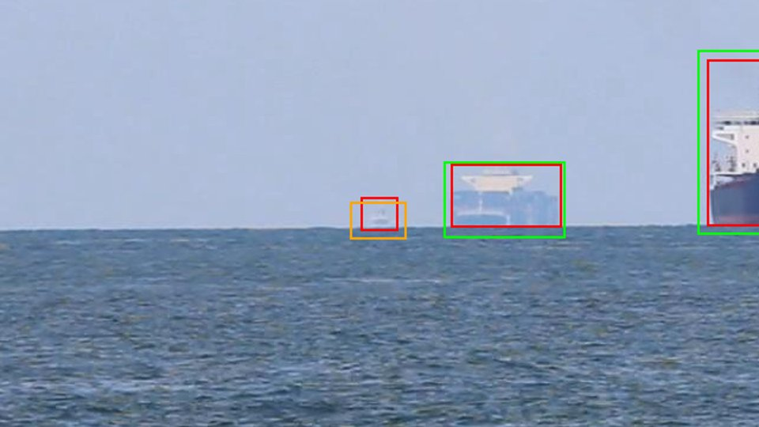
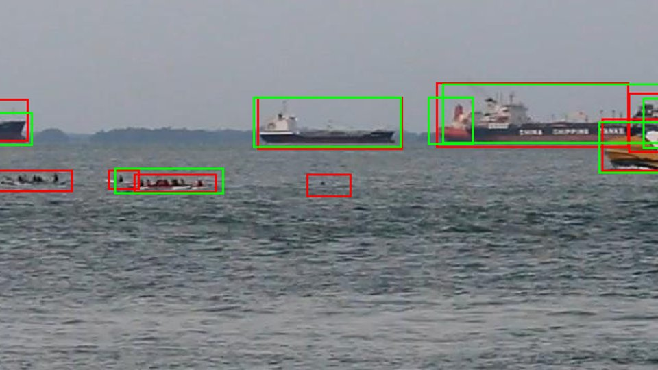
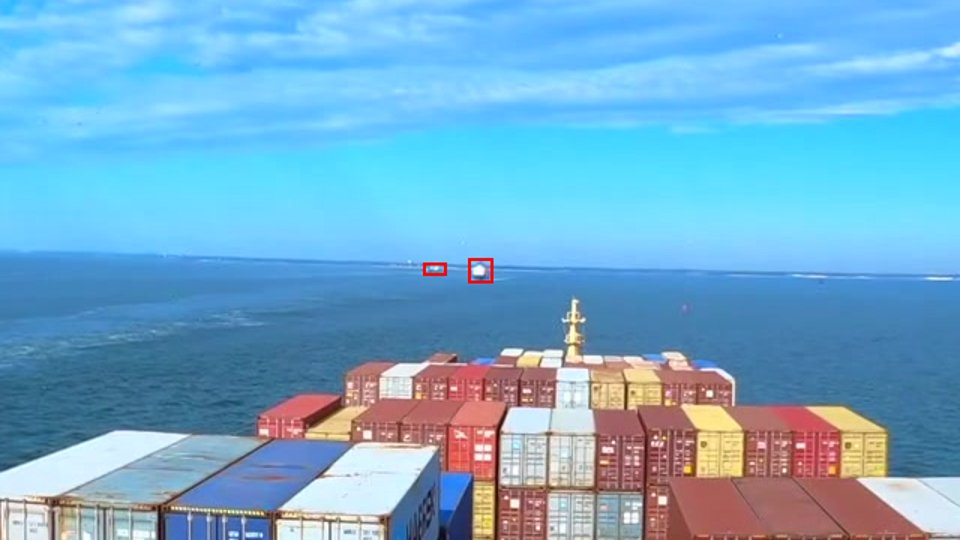
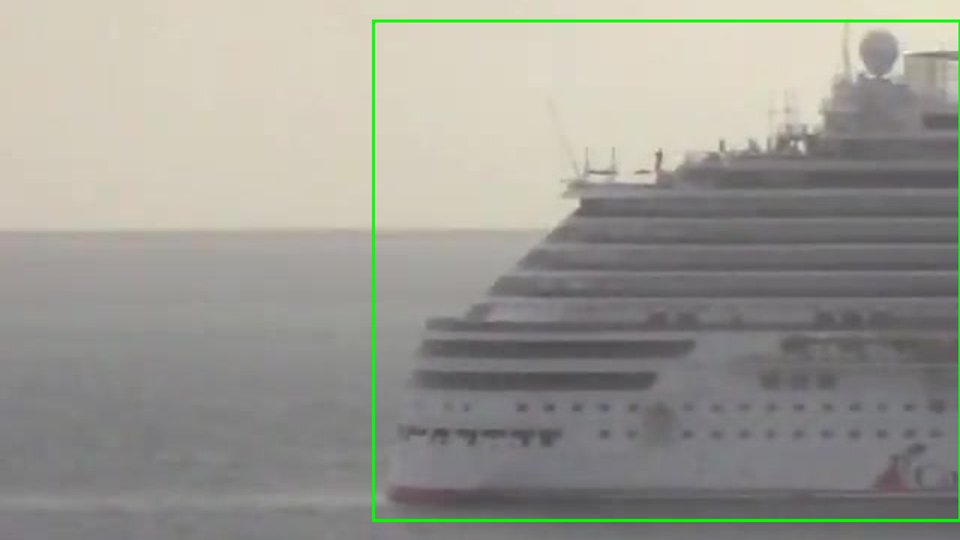

# SHORE RF-DETR-Small fine-tuning — frozen, single-pass evaluation

**Outcome: the ≥95% recall requirement is NOT met.** The valid-selected 1024px
model improves the primary Singapore test, but its day-small CP lower bound is
only **31.37%**, versus **86.33%** for day medium/large. Both primary precision
gates also fail. Generalization is uneven: Ghost Fleet recall and R4 regress
relative to zero-shot. These are prototype measurements, not deployment approval.

## Protocol and artifacts

- Same branch, local commits only; no push. Only the assigned `shore-det-a100`
  (`us-central1-c`, A100-SXM4-40GB) was used. No other VM was created.
- Frozen v2 train/valid and five separate locked sets are unchanged. Training
  uses 15,101 images / 75,904 vessel boxes; valid uses 2,423 / 17,633.
- Both runs start independently from the COCO RF-DETR-Small checkpoint, SHA-256
  `d81979a9213a2109345158ce9232668df4c1ae52e9b8db3f2ec0a8cbad959b33`.
- Environment: `rfdetr==1.3.0`, torch `2.9.1+cu129`, transformers `4.57.1`,
  peft `0.17.1`. The dedicated venv was verified after repeated upstream
  PyTorch deprecation warnings; those warnings were not an unloaded environment.
- `shore_train.py` verifies every canonical train/valid image and manifest hash.
  RF-DETR 1.3 reinitializes a single-category head to **one logit**, so canonical
  category ID 1 causes an out-of-range CUDA index. The first setup attempt failed
  on its first batch. The fix is a **local training-only category 1→0 adapter**
  with absolute references to the frozen image bytes. Categories, annotations,
  and manifests in the freeze were not modified. Predictions map class 0 back
  to canonical evaluation category 1. Unit tests cover this non-mutating adapter.
- Both the canonical training directory and local adapter use `test → valid`
  symlinks. `run_test=False`; no locked set entered a training loader.
- `shore_predict.py` fits on valid only through `shore_eval.py`. For locked
  inference it requires the pre-test selection and exact checkpoint/threshold
  hashes, refuses existing output directories, and warms up with five synthetic
  frames. Each actual locked image is inferred **once per frozen model**.

Artifacts, including weights, predictions, per-frame journals, curves, and metrics:

```
gs://qwiklabs-gcp-02-34a870014566-ghost-seeker/edgeml/shore/runs/finetune-20261105-v1/
  A/                              # native training + weights
  B/                              # high-resolution training + weights
  valid/{A,B}/                    # valid predictions and frozen thresholds
  selection.json                  # generation-zero publication before any test
  locked/{selected,reference}/test_*/
  reference-coco.pth
```

Small committed results: [`shore-finetune-v1`](../configs/shore-finetune-v1/).
No weights, full-frame datasets, or large prediction dumps are in git.

## 1. Tiling sanity check, before training

See [SHORE_TILING_SANITY.md](SHORE_TILING_SANITY.md). No coordinate/scale/NMS
implementation bug was found. The saved tiled predictions match **1,889/1,989
small GT boxes (94.97%)** at the .001 candidate floor. Their maximum matched
small-vessel score is **.809252977**, below the pooled precision-90 threshold
**.861855209**. The exact zero is therefore a threshold effect, not absence of
small-box candidates.

At the native threshold .431105614, tiled small recall is **71.54%**, but pooled
precision is only **56.57%**. Before/after the sanity check, the original frozen
tiled operating point remains **0% small recall**; no fix or new inference pass
was warranted. Re-scoring cached valid predictions and the new offset/NMS tests
completed within 30 minutes, without locked data. Why the crops produce so many
false positives remains unproven; partial labels and crop artifacts are possible
contributors, not established causes. We therefore compare whole-frame resolutions
rather than adopting tiled training crops.

## 2. Training and curves

Both runs: effective batch 16 (microbatch 8, accumulation 2), AdamW through the
library, LR `1e-4`, encoder LR `1.5e-5`, weight decay `1e-4`, .25-epoch warmup,
EMA decay .993 / tau 100, seed 42, four data workers, fixed input resolution
(`multi_scale=False`). Early stopping monitors max regular/EMA valid COCO mAP,
patience 3, minimum improvement .001. Library best regular/EMA mAP selects the
checkpoint within each run; the final **between-run** selection uses shore CP
bounds below. No locked metrics enter either selection.

| Run | Input | Scheduled epochs / LR drop | Completed | Time | Peak allocated GPU | Best valid checkpoint |
|---|---:|---|---:|---:|---:|---|
| A | 512 | 12 / epoch 6 | 7 | 82.20 min | 4.94 GiB | regular, zero-based epoch 3 |
| B | 1024 | 8 / epoch 4 | 4 | 66.45 min | 15.47 GiB | EMA, zero-based epoch 0 |

RF-DETR-Small requires patch-size × window-count divisibility, **16×2=32**.
1024 is also divisible by 64, satisfying the library square-resize convention.
Gradient checkpointing is enabled for B. This is a near-1k, sane-batch budgeted
choice, **not a claim that 1024 is the absolute largest tensor that fits 40GB**;
larger inputs were not swept under the finish-first wall-clock constraint.

Both stopped on validation plateaus before their wall-clock caps (100/160 min).
Completed training totals **8,919.08 s = 2.48 h**, plus the short failed first-batch
setup attempt, comfortably below five hours. We did not spend the remainder on
additional sweeps. First-epoch losses were finite and validation was nonzero:

| Run / epoch (zero-based) | Train loss | Regular mAP / AP50 | EMA mAP / AP50 |
|---|---:|---:|---:|
| A / 0 | 4.6605 | .4490 / .8415 | .4677 / .8605 |
| A / 1 | 3.4638 | .4859 / .8493 | .4891 / .8605 |
| A / 2 | 3.1980 | .4633 / .8490 | .4748 / .8574 |
| A / 3 | 2.9745 | .4914 / .8709 | .4895 / .8592 |
| A / 4 | 2.8119 | .4669 / .8449 | .4768 / .8521 |
| A / 5 | 2.7089 | .4586 / .8304 | .4668 / .8337 |
| A / 6 | 2.5163 | .4601 / .8277 | .4601 / .8267 |
| B / 0 | 4.7268 | .5213 / .9009 | .5378 / .9150 |
| B / 1 | 3.5495 | .5272 / .8928 | .5346 / .9053 |
| B / 2 | 3.2658 | .5199 / .8973 | .5287 / .9023 |
| B / 3 | 3.0157 | .5337 / .9087 | .5354 / .9085 |

Training loss declines without sustained valid improvement. More epochs alone
are not evidence of progress toward the requirement. Library curve mAP is
COCO AP50–95, not the relaxed-small-IoU recall used for requirement scoring.

## 3. Frozen valid selection

Threshold rule: maximize pooled valid recall subject to precision ≥.90, preserving
equal-score groups. Select the run maximizing the **minimum** of day-small and
day-medium/large CP lower bounds; tie-break on their sum, then lower p95 latency.
The minimum prevents easy large vessels from hiding poor small-vessel performance.

All recall/CP/precision values below are percentages. Valid has 1,626 day-small
and 12,455 day-medium/large boxes.

| Run / mode | Tau | Pooled recall / CP | Pooled P | AP50 | Day-small recall / CP / P | Day M+L recall / CP / P | FP/empty, pooled |
|---|---:|---:|---:|---:|---:|---:|---:|
| A / native 512 | .332620502 | 83.66 / 83.20 | 90.01 | .8742 | 76.20 / 74.40 / 93.72 | 85.36 / 84.83 / 87.54 | 0/17 = 0 |
| **B / high-res 1024** | **.335425556** | **85.59 / 85.15** | **90.00** | **.9153** | **85.61 / 84.10 / 94.25** | **84.51 / 83.97 / 90.59** | **4/17 = .2353** |

B wins minimum CP **83.97% vs 74.40%**. Its worse valid R3 was already visible
before test. The prescribed CP-based selection does not enforce R3, and pooled
precision does not guarantee stratum precision (A fails valid day M+L precision).
We did not change the criterion or threshold after seeing these tradeoffs.

The complete [`selection.json`](../configs/shore-finetune-v1/selection.json) was
committed in **`950223e` before any locked inference** and uploaded with a
generation-zero precondition. Its SHA-256 is
`b4f8a8ddcd9a9368e44a7ee427962851fac6810c4ba448641e246db4718c890b`.

```json
{
  "selected_run": "B",
  "mode": "high_res",
  "resolution": 1024,
  "tau": 0.33542555570602417,
  "weights_sha256": "c68087d91c5a05414d4446d9be72b091efc901742493c37f24ef482e3c98696b",
  "threshold_sha256": "6198f706b19dc6457ea3f6e1573a014d4c7a860206535bb51a73c7a6d8080387",
  "reference": "COCO native 512, original valid tau 0.4311056137084961"
}
```

## 4. Locked test, exactly once

All ten model/set passes completed. The journal audit confirms **23,278 actual
image passes = 11,639 images × two models**, unique and complete within every
set/model; checkpoint, threshold, selection, and prediction hashes are retained
in [`audit.json`](../configs/shore-finetune-v1/audit.json). Five synthetic warmups
per pass do not revisit test images. **No test-driven retuning or inference rerun
occurred.** Error examples below use cached predictions only.

### Gated day-EO strata

R1: CP lower bound ≥95%; R2: precision ≥90%; R3: FP per labelled-empty frame
≤.05. PASS/FAIL applies to the measured metric, not dataset qualification.
`—` means unavailable, **not PASS**. Precision can be zero with zero GT when
false detections exist. FP size binning uses predicted area; TP binning uses GT
area, as frozen in the evaluator. R4 is overall MOT-set/window recall, not a
separate size-bin metric (the draft specifies per-stratum R1–R3).

#### Selected B, 1024, tau .335425556

| Set | Day stratum | Boxes | Recall | CP / R1 | Precision / R2 | FP/empty / R3 | Empty frames |
|---|---|---:|---:|---:|---:|---:|---:|
| **test_sg primary** | small | 3,395 | 32.70 | 31.37 FAIL | 84.41 FAIL | — N/A | 0 |
| **test_sg primary** | medium+large | 12,626 | 86.84 | 86.33 FAIL | 85.40 FAIL | — N/A | 0 |
| test_gf | small | 713 | 1.96 | 1.19 FAIL | 100.00 PASS | .0000 PASS | 845 |
| test_gf | medium+large | 6,016 | 75.62 | 74.69 FAIL | 89.60 FAIL | .0379 PASS | 845 |
| test_fvessel | small | 1 | 0.00 | 0.00 FAIL | 0.00 FAIL | .0000 PASS | 4 |
| test_fvessel | medium+large | 1,753 | 67.88 | 66.00 FAIL | 93.11 PASS | .7500 FAIL | 4 |
| test_smd | small | 0 | — | — N/A | 0.00 FAIL | — N/A | 0 |
| test_smd | medium+large | 72 | 91.67 | 84.21 FAIL | 92.96 PASS | — N/A | 0 |
| test_seaships | small | 9 | 55.56 | 25.14 FAIL | 62.50 FAIL | — N/A | 0 |
| test_seaships | medium+large | 4,661 | 94.34 | 93.75 FAIL | 89.73 FAIL | — N/A | 0 |

#### Zero-shot native reference, 512, original valid tau .431105614

| Set | Day stratum | Boxes | Recall | CP / R1 | Precision / R2 | FP/empty / R3 | Empty frames |
|---|---|---:|---:|---:|---:|---:|---:|
| test_sg | small | 3,395 | 2.97 | 2.51 FAIL | 24.57 FAIL | — N/A | 0 |
| test_sg | medium+large | 12,626 | 70.21 | 69.54 FAIL | 86.01 FAIL | — N/A | 0 |
| test_gf | small | 713 | 31.14 | 28.28 FAIL | 72.79 FAIL | .0201 PASS | 845 |
| test_gf | medium+large | 6,016 | 85.36 | 84.58 FAIL | 88.92 FAIL | .0237 PASS | 845 |
| test_fvessel | small | 1 | 0.00 | 0.00 FAIL | 0.00 FAIL | .5000 FAIL | 4 |
| test_fvessel | medium+large | 1,753 | 61.10 | 59.14 FAIL | 40.13 FAIL | 2.2500 FAIL | 4 |
| test_smd | small | 0 | — | — N/A | 0.00 FAIL | — N/A | 0 |
| test_smd | medium+large | 72 | 86.11 | 77.58 FAIL | 92.54 PASS | — N/A | 0 |
| test_seaships | small | 9 | 100.00 | 71.69 FAIL | .43 FAIL | — N/A | 0 |
| test_seaships | medium+large | 4,661 | 76.61 | 75.57 FAIL | 69.94 FAIL | — N/A | 0 |

**Coverage qualification:** Singapore has ≥300 boxes / five held-out recordings
in both day gates. Ghost Fleet has 713 small boxes but only three contributing
recordings; its medium/large stratum has seven. FVessel has two recordings,
SMD only 72 boxes / two recordings, and SeaShips recording lineage is unknown
(its thousands of `source_video` values are image IDs). Those supplemental sets
cannot establish both draft coverage gates. No primary vessel-empty frames exist,
so primary R3 cannot be certified regardless of recall performance.

### R4, two-second fully observed sliding track windows

| MOT set | Eligible tracks / windows | Selected detected / recall | R4 ≥98% | Reference detected / recall | R4 ≥98% |
|---|---:|---:|---|---:|---|
| test_gf | 39 / 6,947 | 4,741 / 68.25% | FAIL | 5,272 / 75.89% | FAIL |
| test_fvessel | 7 / 1,747 | 1,258 / 72.01% | FAIL | 1,133 / 64.85% | FAIL |

Other sets lack track IDs: R4 is N/A. Gaps break windows and incomplete tails
are excluded. These overlapping windows are strongly correlated, not independent
trials. Norfolk segments remain separate track-ID/frame-index scopes while being
counted as one recording for source coverage.

### Tiny and low-light — report only

Cells are recall / CP lower / precision, percentages. Full FP/empty and AP50
values for every size and lighting stratum are in the committed metrics JSONs.

| Set / stratum | Boxes | Selected R / CP / P | Reference R / CP / P |
|---|---:|---:|---:|
| Singapore / tiny | 30 | 0 / 0 / — | 0 / 0 / 0 |
| Singapore / low-light | 0 | — | — |
| Ghost Fleet / tiny | 644 | 0 / 0 / — | 4.97 / 3.64 / 100 |
| Ghost Fleet / low-light | 3 | 0 / 0 / 0 | 0 / 0 / — |
| FVessel / tiny, low-light | 0 each | — | — |
| SMD / tiny, low-light | 0 each | — | — |
| SeaShips / tiny | 0 | — | — / — / 0 |
| SeaShips / low-light | 13 | 76.92 / 50.54 / 83.33 | 46.15 / 22.40 / 46.15 |

The Ghost Fleet low-light positives occur in a dark fade, not established real
night operation. SeaShips supplies just 13 low-light positives with unknown
recording independence. Valid twilight MVI_1578 does not constitute a locked
night test. There is no IR evidence.

| Locked set | All-box recall, selected / reference | AP50, selected / reference |
|---|---:|---:|
| Singapore | 75.22 / 55.86 | .7980 / .6644 |
| Ghost Fleet | 61.86 / 73.06 | .8485 / .8592 |
| FVessel | 67.84 / 61.06 | .7912 / .5795 |
| SMD | 91.67 / 86.11 | .9026 / .9128 |
| SeaShips | 94.21 / 76.57 | .9562 / .7357 |

The reference threshold is from Singapore+SMD valid, **not a SeaShips-tuned
threshold**. Its SeaShips AP50 remains close to the earlier .735 bakeoff result,
but that does not imply 90% precision transfers at this frozen threshold.

## 5. Latency on the assigned A100

Eager, unoptimized, batch-one end-to-end preprocessing + synchronized detection,
excluding decode/disk IO, prediction serialization, and five synthetic warmups.
Only actual 1920×1080 frames enter these percentiles; other sizes are not silently
rescaled to manufacture 1080p timing. No GPU jobs ran concurrently during locked
latency measurements.

| Measurement | 1080p frames | p50 ms | p95 ms |
|---|---:|---:|---:|
| A native, valid | 2,423 | 82.11 | 83.15 |
| B selected 1024, valid | 2,423 | 88.06 | 88.86 |
| **B selected 1024, pooled locked** | **9,999** | **84.90** | **88.88** |
| Zero-shot native, pooled locked | 9,999 | 80.76 | 86.20 |

These are **A100**, not L4 measurements. **R5 is unverified**, not passed. Runtime,
image preprocessing, compilation, contention, and memory behavior on the actual
shore L4 need separate measurement.

## 6. Failure evidence and limitations

The four reviewed crops below total **220,100 bytes including their metadata**,
well below 3 MB. Red = vessel GT, green = retained detection, orange = an
IoU-qualified candidate below the frozen threshold. Crops are enlarged 1.5×;
source IDs, original boxes, crop coordinates, and scores are in
[`examples.json`](shore_assets/examples.json). No new inference or threshold
selection was performed to make them.

1. **Low-score rejection is the dominant measured miss mechanism.** Of 3,977
   Singapore misses, 3,588 already have an IoU-qualified candidate at the .001
   floor but fall below the frozen score threshold; Ghost Fleet has 2,792 such
   misses out of 2,813. This verifies score rejection, not its underlying cause.
   The image below shows a small mvi1644 vessel with score **.335271180**, just
   below frozen **.335425556**. We did not lower the threshold on test. The much
   worse small recall on locked Singapore (32.70%) than valid (85.61%) and on
   Ghost Fleet (1.96%) demonstrates poor operating-point transfer. Training size
   imbalance and source/camera shift are plausible contributors, not proven
   explanations.

   

2. **Low-contrast/localization failures remain.** Another 389 Singapore misses
   and 21 Ghost Fleet misses have no candidate satisfying the IoU/floor rule.
   This includes absent detections and inadequate localization, not necessarily
   failure to produce any nearby box. The mvi1609 crop shows a small annotated
   contact amid much larger vessels and textured water.

   

3. **Tiny-contact operating recall remains effectively absent.** The selected
   model misses all 644 labelled Ghost Fleet tiny observations at the frozen
   threshold. The Norfolk crop shows very small distant contacts; its training
   pool had just two tiny boxes. This limited coverage cannot support a tiny
   accuracy claim.

   

4. **Labelled-empty is not reliably vessel-empty.** In Ghost Fleet image 1856,
   a .9246-score detection visibly encloses a cruise ship, yet the frozen frame
   has no vessel GT. It therefore counts as an R2/R3 false positive even though
   the crop clearly contains a ship. This is direct evidence of at least one
   completeness problem, not proof that all reported false positives are real
   vessels. R3 uses the frozen labels without repairing them after test.

   

Additional caveats:

- **No exhaustive human completeness/localization audit.** The draft's human-QA
  prerequisite is not satisfied. Repaired joins and clean hashes do not establish
  annotation completeness; R2/R3 are especially sensitive to omitted boats.
- **Correlation:** CP bounds treat box observations as independent binomial
  trials. Repeated frames of the same hull and overlapping track windows violate
  that idealization. These are descriptive bounds, not independent-encounter
  certification. Singapore has five held-out videos, not five verified cameras.
- **Provenance:** SeaShips recording separation is unresolved; FVessel shares a
  camera/day between train/test recordings. Public COCO/DINOv2 pretraining overlap
  with public maritime imagery has not been ruled out.
- **Licenses:** Singapore/SeaShips licenses remain unknown; SMD has academic-use
  restrictions/unknowns; FVessel and source videos require license review. Code,
  backbone, and checkpoint terms also require review before deployment or external
  distribution. Crops here are for internal review, not redistribution clearance.
- **No L4 certification, no substantial locked night/IR evidence, and no field
  safety validation.** An A100 timing result does not satisfy the L4 requirement.

Recommended next work is audited, source-diverse positive and genuine sea-empty
labels, additional small/tiny training coverage, and validation that represents
the deployment sources. Investigate score calibration without using these test
results to choose a new operating point. These locked sets have now been consumed
for this experiment; subsequent improvement claims need a fresh predeclared
assessment protocol, not repeated tuning against these scores. Do not deploy or
claim 95% accuracy from this run.

## Checks

After the corresponding final code edits (unchanged suites were not repeated):

```
# New tiling offset/NMS cases
..                                                                       [100%]
2 passed in 0.07s

# Training adapter/budget + existing shore metric/export regression tests
.............                                                            [100%]
13 passed in 0.45s

# Frozen authorization and CP-based selection
..                                                                       [100%]
2 passed in 0.32s
```

The completed single-pass artifact audit printed:

```json
{
  "actual_image_passes": 23278,
  "single_pass_verified": true
}
```

All training, valid, locked-prediction, and reference-checkpoint GCS upload commands
completed with exit code 0. Failure crops were visually inspected. Detailed JSONs
include AP50, precision, empty-frame counts, CP bounds, and R4 denominators rather
than converting unavailable quantities to passes.
